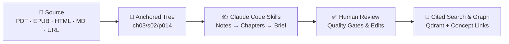

<div align="center">

# 📚 Bookshelf

**Read once, keep forever.**  
Turn books, papers, and web articles into anchored notes, 1-page briefs, audio summaries, and a cited idea graph. 🧠✨

[](https://www.python.org)
[](https://fastapi.tiangolo.com)
[](https://astro.build)
[](https://react.dev)
[](https://www.postgresql.org)
[](https://qdrant.tech)
[](https://docs.claude.com/en/docs/claude-code)

[**How It Works**](#-how-it-works) · [**Quickstart**](#-quickstart) · [**Usage**](#-using-bookshelf) · [**Deployment**](#️-deployment--infrastructure) · [**Docs**](#️-documentation-map)

</div>

---

## ✨ How it works

Drop a PDF, EPUB, or URL into `library/`. Bookshelf parses it into an addressable semantic tree, distils it bottom-up using **Claude Code skills**, routes everything through a human review queue, and indexes what you approve for cited search and cross-book concept linking.



### Why Bookshelf?

- 🎯 **Every note has an address** — Blocks (`meadows-systems/ch03/s02/p014`), not arbitrary token chunks. Distillations, highlights, and graph edges cite exact passages.
- 🧑‍⚖️ **Human in the loop** — Automated quality gates check grounding, coverage, and compression before anything enters your review queue or search index.
- 🔎 **Two-tier retrieval** — Search dense chapter distillations to see *what you know*, then drop to exact source blocks for *verbatim evidence*.
- 🕸️ **Living idea graph & study tools** — Connect concepts across books, review bite-sized **Pills**, listen to narrated audio summaries, or spin up code **Builds** from scientific papers.
- 🔑 **Zero API keys** — Every model call runs through your logged-in `claude -p` CLI session.

---

## 🧰 Prerequisites

| Requirement | Version / Notes | Purpose |
| :--- | :--- | :--- |
| **[Python](https://www.python.org) + [uv](https://docs.astral.sh/uv/)** | Python `≥ 3.12` | FastAPI backend, parser & job worker |
| **[Node.js](https://nodejs.org) + [pnpm](https://pnpm.io/)** | Node `≥ 22.12` | Astro + React frontend |
| **[PostgreSQL](https://www.postgresql.org)** | `15+` server binaries | Local DB in `.pgdata/` (or use Podman / Supabase) |
| **[Claude Code](https://docs.claude.com/en/docs/claude-code)** | Logged in (`claude` → `/login`) | Runs all distillation skills & build agents |

---

## 🚀 Quickstart

Get a complete local stack running in 3 steps:

```bash
# 1. Start an isolated local Postgres in .pgdata/ (port 54329, no password)
scripts/pg-local.sh start

# 2. Start the backend API + background job worker (http://127.0.0.1:8000/docs)
cd backend
uv sync
cp .env.example .env
uv run python -m app.db.migrate
uv run fastapi dev app/main.py

# 3. Start the frontend in a new terminal (http://localhost:4321)
cd frontend
cp .env.example .env
pnpm install
pnpm dev
```

🎉 **You're live!** Open `http://localhost:4321`, drop a file into `library/`, and click **Ingest**.

> [!TIP]
> - **Podman shortcut:** `scripts/dev-backend.sh` starts a Podman Postgres container on port `54330` (shown as *"This computer"* in Settings → Database) alongside `fastapi dev` (`PG_KEEP=1` keeps it running; manage manually with `scripts/pg-podman.sh start|stop|status|logs|reset`).
> - **Standalone worker:** Run `cd backend && uv run python -m app.jobs.worker` in a separate terminal (set `BOOKSHELF_API_WORKER=false` on the API if you only want external workers; `GET /api/v1/jobs/queue` lists live workers).
> - **Production frontend preview:** `cd frontend && pnpm build && pnpm serve`.

---

## 📖 Using Bookshelf

### Adding books, papers & articles
1. **Local files:** Drop `.pdf`, `.epub`, `.html`, or `.md` files into `library/` (originals are never modified) and click **Ingest** in the UI, or call `POST /api/v1/documents {"path": "library/book.pdf"}`.
2. **Web articles:** Ingest any URL via the UI or `POST /api/v1/documents {"url": "https://..."}`.
3. **Outline review:** PDFs without an embedded table of contents pause in **Needs Review** so you can tweak or confirm chapters in the outline editor.

### 🤖 Interactive Claude Code skills
Want to collaborate with Claude instead of running batch jobs? Open Claude Code in the repo root and invoke any skill directly:

```text
/distil-chapter meadows-systems ch03
```

The skill fetches the exact inputs from `GET /api/v1/skills/{name}/inputs`, works through the distillation with you interactively, writes to `skills/.outbox/`, and imports the validated artifact via `POST /api/v1/artifacts/import`. Set `BOOKSHELF_API` (default `http://127.0.0.1:8000/api/v1`) and `BOOKSHELF_API_KEY` if authentication is enabled.

---

## 🗂️ Repository layout

```text
bookshelf/
├── backend/       # FastAPI app, parsers, pipeline runner, job queue & migrations
├── frontend/      # Astro 7 + React 19 web app, reader, graph explorer & study views
├── skills/        # Versioned Claude Code prompt packages (SKILL.md + schema + meta)
├── agents/        # Autonomous Claude Code agents for paper-to-repo builds
├── contracts/     # Shared JSON Schemas across backend, skills, and frontend
├── supabase/      # Plain-SQL PostgreSQL migrations
├── scripts/       # Local Postgres, Podman, narration & demo helper scripts
├── docs/          # Deep-dive architecture and feature design specs
└── library/       # Drop your PDFs, EPUBs, HTML & Markdown files here
```

> **Derived data is disposable:** `.media/` (cropped figures/formulas), `.audio/` (narrations), `.qdrant/` (embedded vectors), and `exports/` are all generated from Postgres and can be rebuilt anytime.

---

## ⚙️ Deployment & infrastructure

<details>
<summary><b>🟢 Pointing at Supabase</b></summary>

1. Apply migrations in `supabase/migrations/` via the Supabase MCP (`apply_migration`) or CLI (`supabase link && supabase db push`).
2. Set the **Session pooler** connection string (Project → Connect → Session pooler) in `backend/.env`:
   ```ini
   BOOKSHELF_DATABASE_URL=postgresql+psycopg://postgres.<ref>:<password>@aws-0-<region>.pooler.supabase.com:5432/postgres
   ```

Row-Level Security (RLS) is enabled with zero grants to `anon` or `authenticated` — only the backend reads and writes.
</details>

<details>
<summary><b>🐘 Pointing at your own Postgres server (VM)</b></summary>

Any PostgreSQL 15+ instance works out of the box:

1. Create the role and database on your server:
   ```bash
   sudo -u postgres psql -c "create role bookshelf login password '<password>'"
   sudo -u postgres psql -c "create database bookshelf owner bookshelf"
   # postgresql.conf: listen_addresses = '*'   (or private interface)
   # pg_hba.conf:     hostssl bookshelf bookshelf <your-ip>/32 scram-sha-256
   sudo systemctl restart postgresql
   ```
   Keep port `5432` restricted to your IP, or connect over a VPN / SSH tunnel (`ssh -L 5433:127.0.0.1:5432 <vm>`).
2. Configure `backend/.env` (`PGHOST` overrides `BOOKSHELF_DATABASE_URL`; add `PGSSLMODE=require` when using TLS):
   ```ini
   PGHOST=<vm-host>
   PGPORT=5432
   PGDATABASE=bookshelf
   PGUSER=bookshelf
   PGPASSWORD=<password>
   ```
3. Run `cd backend && uv run python -m app.db.migrate` (automatically skips Supabase-managed databases by detecting `supabase_admin`).
4. Use **Settings → Database** in the UI to sync your local database up to the server or restore a snapshot.
</details>

<details>
<summary><b>🔍 Pointing at a Qdrant server or Qdrant Cloud</b></summary>

By default, Qdrant runs embedded in `.qdrant/` inside the API process. To use an external server (`docker run -p 6333:6333 qdrant/qdrant`) or Qdrant Cloud, set in `backend/.env`:

```ini
BOOKSHELF_QDRANT_URL=https://<cluster>.cloud.qdrant.io:6333
BOOKSHELF_QDRANT_API_KEY=<key>
```

Collections are created automatically on first use. Rebuild the entire vector index anytime from Postgres with `POST /api/v1/jobs {"kind": "embed"}`.
</details>

---

## 🧪 Testing & quality checks

```bash
# Backend (requires scripts/pg-local.sh start)
cd backend
uv run pytest
uv run ruff check . && uv run mypy app

# Frontend
cd frontend
pnpm test
pnpm lint
```

---

## 🗺️ Documentation map

| Guide | What it covers |
| :--- | :--- |
| [**Architecture (`docs/ARCHITECTURE.md`)**](docs/ARCHITECTURE.md) | Core data model, addressable blocks, two-tier retrieval & quality gates |
| [**Scientific Papers (`docs/PAPERS.md`)**](docs/PAPERS.md) | Dedicated paper pipeline, claim extraction, cross-paper comparisons & ratings |
| [**Paper Builds (`docs/BUILDS.md`)**](docs/BUILDS.md) | Turning papers into runnable git repositories with [`agents/`](agents/README.md) |
| [**Pills (`docs/PILLS.md`)**](docs/PILLS.md) | Bite-sized cited learning feed harvested from your shelf |
| [**Job Queue (`docs/QUEUE.md`)**](docs/QUEUE.md) | Background workers, concurrency, retries & live SSE streaming |
| [**Backend (`backend/README.md`)**](backend/README.md) | API endpoints, worker flags, audio narration & CLI commands |
| [**Skills (`skills/README.md`)**](skills/README.md) | Authoring and configuring Claude Code distillation skills |
| [**Read-Only Demo (`docs/DEMO.md`)**](docs/DEMO.md) | Deploying a public read-only showcase on Render + Vercel |

