# Bookshelf — Design & Architecture

**Status**: proposed · **Date**: 2026-09-21 · **Owner**: agharsallah

---

## 1. What this is

A personal knowledge system that turns long-form reading (mostly PDFs, plus articles) into a
**structured, cited, navigable knowledge base** — and keeps the human in the loop.

Three promises, in priority order:

1. **Read once, keep forever.** Every book becomes a chapter-level distillation plus a one-page
   brief, both traceable back to the exact passage they came from.
2. **Ask, don't dig.** Ask a question and get an answer assembled from what you have already
   read, with citations you can click into.
3. **See the connections.** Concepts link across books, so the shelf behaves like one corpus
   rather than a stack of isolated files.

Scientific papers have a dedicated mode on the same infrastructure (own pipeline profile,
skills, tables and pages: claims, results, citations, ratings, reading recommendations). Its
design lives in [PAPERS.md](PAPERS.md); this document covers what both share.

### Explicit non-goals

Named so they stop showing up in scope discussions:

| Not building | Why |
|---|---|
| Generated videos | Highest cost, lowest knowledge value per hour of work. Narration was on this list; audio summaries (§9) are now in, as derived study material |
| Multi-user accounts, sharing, permissions | Single-user system; auth is one API key (already built) |
| Mobile app | Responsive web is enough |
| Real-time collaborative editing | No second user |
| Web crawling / feed ingestion | Ingest is deliberate: you choose what enters the shelf |
| DOCX, audio | PDF, EPUB and HTML cover the real corpus; the parser interface leaves the seam |

Quizzes, FAQs, flashcards, glossaries, and quote extraction **are** in scope, but last (§15) —
they are cheap once the distillation layer exists and worthless before it.

---

## 2. The core idea, enriched

The original idea is "parse, distil, search". The three additions that make it more than a
notes app:

**a. The block is the atom, and it has an address.**
Not pages, not arbitrary 512-token chunks. A *block* is a semantic leaf (paragraph, list, table,
figure caption) that lives at a stable address in the document tree:
`meadows-systems/ch03/s02/p014`. Distillations cite addresses. Notes attach to addresses.
Graph edges point at addresses. Highlights are ranges over addresses. One primitive, and
everything else composes onto it.

**b. Two retrieval tiers, not one RAG blob.**
Search the *distillation* layer to find out **what you know about X**; drop to the *block* layer
to get the **evidence and the exact words**. Most questions are answered from a handful of
chapter distillations — dense, deduplicated, already-written prose — with raw passages pulled in
only for grounding. This is the difference between "a RAG app over book chunks" and a system
that gets better as you read more.

**c. Derived data is disposable.**
Postgres holds the source of truth: document structure, block text, your notes, provenance.
Everything else — Markdown exports, embeddings, the Qdrant index, the concept graph, the briefs
themselves — is derived and rebuildable from scratch by re-running jobs. That single rule is
what makes it safe to iterate aggressively on prompts and parsers.

---

## 3. Four layers

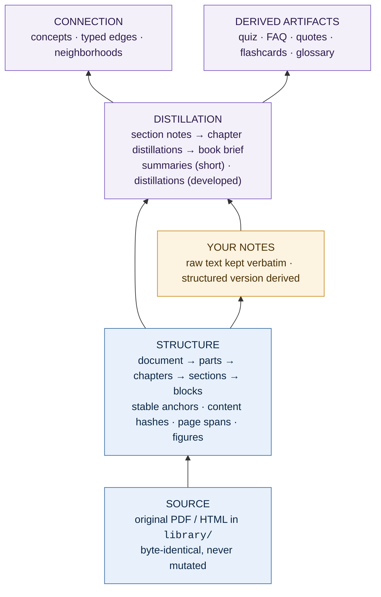

Each layer only reads the layer below it. A distillation never reads another distillation of the
same rank; a chapter distillation is built from *its* section notes, nothing else. That
constraint is what prevents the duplication the idea dump worries about (§9).

Two layers are **source of truth** (blue) and are never regenerated. Everything purple is derived
and rebuildable. Your notes (amber) sit in between: the raw text is source of truth, the
structured version is derived.

---

## 4. System shape

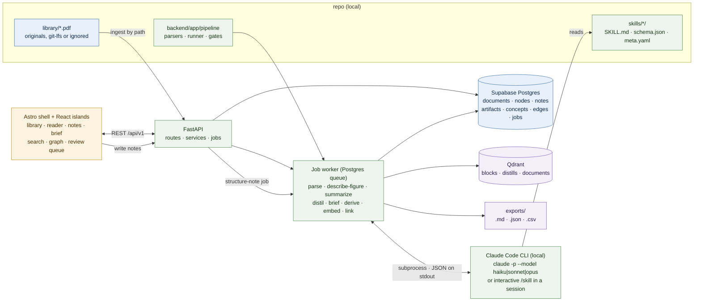

**Mapping to what exists today**: `backend/` already provides the app factory, settings,
guardrails, error envelope, and a `books` resource — that resource becomes `documents`.
`frontend/` is Astro; it stays Astro with React islands (§12). The Qdrant key in `.env` is for
the index in §10. Postgres is the Supabase project; schema changes go through Supabase
migrations.

**PDFs stay in the repo for now** (D13). `library/` holds the originals; ingest takes a path,
not an upload. `documents.source_path` points at the file, `sha256` guards against duplicates.
An object store is a later swap behind the same `SourceStore` interface, not a phase-0 concern.

---

## 5. Architectural decisions

Each decision states the call, the reason, and what it costs.

| # | Decision | Rationale | Consequence |
|---|---|---|---|
| D1 | **Postgres is the only source of truth; Qdrant, exports, and artifacts are derived** | Lets you rewrite prompts and parsers without fear | Every derived store needs a rebuild job from day one |
| D2 | **Markdown is an export format, not the store** | Markdown files drift, lose anchors, and can't be queried | Reader renders from structured JSON, not from `.md` |
| D3 | **Parsing is ToC-driven, not page-driven** | Chapter/section boundaries are the unit humans think in, and the unit distillation needs | Documents without an outline need a heading-detection fallback plus a manual fix-up UI (§8) |
| D4 | **Blocks carry stable anchors and content hashes** | Anchors survive re-parsing; hashes make re-runs incremental | Anchor assignment must be deterministic, not row-id based |
| D5 | **Skills are versioned prompt packages executed as jobs** | Reproducible, diffable, cheap to re-run on one chapter | Needs a job table, an artifact-versioning scheme, and a review queue |
| D6 | **Every generated sentence cites block anchors** | Makes hallucination visible and the reader clickable | Skills must emit structured output, not prose (§9) |
| D7 | **Distillation is strictly bottom-up and rank-isolated** | Removes duplication by construction, not by a cleanup pass | A book-level dedup pass is still needed across chapters |
| D8 | **Retrieval resolves an address before it searches** | "Summarize chapter 3" is a lookup, not a similarity problem | Query router needs an intent step (§10) |
| D9 | **The graph is a derived edge table in Postgres, not a graph database** | At this corpus size, recursive CTEs over an indexed edge table are fast and free | Deep traversals (>3 hops) stay out of scope |
| D10 | **Astro shell + React islands, no framework rewrite** | The existing frontend already works; only three surfaces are genuinely interactive | Islands must own their own state; no global client store |
| D11 | **AI never edits your words** | Your notes are the one irreplaceable artifact | `note.raw` immutable; structured version is a separate derived row |
| D12 | **No quantization, single Qdrant node** | Hundreds of documents ≈ 10²–10⁵ vectors; quantization adds complexity and recall loss for nothing | Revisit past ~1M vectors |
| D13 | **Originals live in `library/` inside the repo; ingest by path** | No upload plumbing, no object store, no auth on binaries for a single-user tool | `SourceStore` interface so the swap to S3/Supabase Storage later is one adapter |
| D14 | **Summary and distillation are different artifact types** | A summary is short and lossy (what is this about?); a distillation is developed and keeps the load-bearing content (what do I need to retain?) | Two skills, two schemas, two compression bands (§9, §14) |
| D15 | **Humans and skills author the same artifact types** | You can write a chapter distillation by hand; the system treats it like an approved skill output | `artifacts.origin` = `human` \| `skill:<name>@<v>`; human artifacts skip the grounding gate but still carry `cites` |
| D16 | **Model ladder: cheapest model that passes the gates** | Exploration and classification are high-volume, low-stakes; briefs and concept linking are the opposite | Every skill declares its tier in `meta.yaml`; `artifacts.model` records what actually ran, so quality vs. cost is measurable per skill |
| D18 | **Claude Code CLI is the model runtime; no API key in the backend** | Skills already run there; subscription covers the cost; interactive exploration is free-form | Worker shells out to `claude -p`; structured output enforced by post-validation; concurrency capped; a `ModelRunner` seam keeps the API swap possible |
| D19 | **Papers are a document genre with their own pipeline profile** (`documents.genre`) | Reuses tree, anchors, artifacts, gates, search, graph and FSRS; a paper still needs its own ranks, skills and atoms (claims, results, references) | Orchestrator rules are chosen per genre (`rules_for`); see [PAPERS.md](PAPERS.md) P1–P9 |
| D17 | **Non-prose content is parsed, not skipped** | Charts, diagrams, tables, code, and formulas often carry the argument; a distillation that ignores them is of a weaker book | Region classifier at parse time; per-kind skills (`describe-figure`, `explain-code`, `describe-math`, `explain-table`) emit structured, cited blocks; one call per element, never per page |

---

## 6. Data model

Postgres from day one (Supabase in production, a project-local cluster for dev and tests).
The canonical DDL lives in `supabase/migrations/*.sql`; the sketch below is the shape, the
migrations are the truth (they add check constraints, queue columns and RLS — see §18).

```sql
-- SOURCE ---------------------------------------------------------------
create table documents (
  id            uuid primary key,
  kind          text not null,              -- 'pdf' | 'epub' | 'article'
  slug          text not null unique,        -- 'meadows-systems'
  title         text not null,
  authors       text[] not null default '{}',
  year          int,
  source_uri    text,                        -- original URL, if any
  source_path   text,                        -- 'library/meadows-systems.pdf' (D13)
  sha256        text not null,               -- dedupe: same file never ingested twice
  page_count    int,
  language      text default 'en',
  status        text not null,               -- see §7 state machine
  tags          text[] not null default '{}',
  created_at    timestamptz not null default now()
);

-- STRUCTURE ------------------------------------------------------------
-- One row per node of the document tree. Chapters and sections are the same
-- shape at different depths; blocks are the leaves.
create table nodes (
  id            uuid primary key,
  document_id   uuid not null references documents on delete cascade,
  parent_id     uuid references nodes on delete cascade,
  anchor        text not null,               -- 'ch03/s02/p014'  (stable, deterministic)
  kind          text not null,               -- part|chapter|section|paragraph|list|table|figure|code|math|aside|quote
  ordinal       int  not null,               -- sibling order
  depth         int  not null,
  heading       text,                        -- set on part/chapter/section
  text          text,                        -- set on leaves
  content_hash  text,                        -- sha256 of normalized text; drives incremental re-runs
  page_from     int,
  page_to       int,
  meta          jsonb not null default '{}', -- table shape, figure caption + image_path, footnote refs
  unique (document_id, anchor)
);
create index on nodes (document_id, parent_id, ordinal);
create index on nodes (document_id, kind);

-- HUMAN ----------------------------------------------------------------
create table notes (
  id            uuid primary key,
  document_id   uuid not null references documents on delete cascade,
  anchor        text not null,               -- what it is attached to
  range         jsonb,                       -- {start,end} char offsets for highlights
  raw           text not null,               -- YOUR WORDS. never rewritten (D11)
  color         text,                        -- highlight tone
  target        text not null default 'source', -- or chapter_distillation / chapter_summary
  artifact_id   uuid references artifacts on delete set null, -- the pane passage's artifact
  block         int,                         -- its render block (range is into that block's text)
  quote         text,                        -- the marked words, kept across artifact versions
  created_at    timestamptz not null default now()
);

-- Your place in each chapter opened in the reader. Anchors are not foreign keys: a
-- re-parse keeps your place, and a vanished anchor falls back to its chapter.
create table reading_positions (
  document_id   uuid not null references documents on delete cascade,
  unit          text not null,               -- the chapter
  anchor        text not null,               -- the block last read: where to continue
  progress      real not null,               -- furthest point reached, 0–1, only grows
  updated_at    timestamptz not null default now(),
  primary key (document_id, unit)
);

-- Remembering it (§9). A recall is a chapter written from memory, a prediction what you
-- expected it to argue; both immutable (trigger, D11). Grades are derived and replaceable.
create table recalls (
  id            uuid primary key,
  document_id   uuid not null references documents on delete cascade,
  unit          text not null,               -- the chapter
  kind          text not null,               -- recall | prediction
  raw           text not null,               -- YOUR WORDS, never edited
  created_at    timestamptz not null default now()
);
create table recall_grades (                 -- one per recall, from grade-recall
  recall_id     uuid primary key references recalls on delete cascade,
  prediction_id uuid references recalls on delete set null,
  ideas         jsonb not null,              -- [{id, tier, text, cites, status, feedback, cue?}]
  question      jsonb,                       -- {idea, text, cites}: one "why is this true?"
  comparison    jsonb,                       -- {predicted, argues, ideas, cites}
  origin        text not null, model text, created_at timestamptz not null default now()
);
-- What comes back for spaced retrieval, on an FSRS schedule (py-fsrs).
create table review_items (
  id            uuid primary key,
  document_id   uuid not null references documents on delete cascade,
  anchor        text not null,               -- the passage the answer rests on
  source        text not null,               -- recall | question | flashcard
  source_key    text not null,               -- unique per source: one item per idea / card
  prompt        text not null,               -- all a review shows before you answer
  answer        jsonb not null,              -- cited spans, revealed for a typed attempt
  card          jsonb not null,              -- FSRS card state
  due           timestamptz not null,        -- copied out of `card`, indexed
  last_rating   smallint,
  unique (source, source_key)
);
create table review_logs (                   -- every review: rating + what you typed
  id uuid primary key, item_id uuid not null references review_items on delete cascade,
  rating smallint not null, answer text, reviewed_at timestamptz not null default now()
);

-- DISTILLATION ---------------------------------------------------------
-- Every AI output lands here. Immutable and versioned: a re-run inserts a new
-- version, the old one stays for diffing.
create table artifacts (
  id            uuid primary key,
  document_id   uuid not null references documents on delete cascade,
  anchor        text,                        -- scope: null = whole document
  type          text not null,               -- see artifact catalogue (§7)
  version       int  not null,
  origin        text not null,               -- 'human' | 'skill' (D15)
  skill         text,                        -- 'distil-chapter'; null when origin = human
  skill_version text,                        -- '3'
  model         text,                        -- resolved model from CLI result; null when origin = human
  run_mode      text,                        -- batch | interactive
  tier          text,                        -- explore|distil|reason (D16)
  input_hash    text not null,               -- hash of the exact inputs; makes re-runs idempotent
  body          jsonb not null,              -- render-contract blocks (§9)
  citations     text[] not null default '{}', -- every anchor referenced by body
  review        text not null default 'draft', -- draft|approved|rejected
  created_at    timestamptz not null default now(),
  unique (document_id, anchor, type, version)
);
create index on artifacts (document_id, type, review);
create unique index on artifacts (type, input_hash, skill_version)
  where review <> 'rejected';                -- never pay twice for the same input

-- CONNECTION -----------------------------------------------------------
create table concepts (
  id            uuid primary key,
  canonical     text not null unique,        -- 'feedback loop'
  aliases       text[] not null default '{}',
  kind          text not null,               -- concept|framework|person|work|term
  blurb         text,                        -- one sentence, itself cited
  created_at    timestamptz not null default now()
);

create table edges (
  id            uuid primary key,
  src_kind      text not null,               -- 'node' | 'concept' | 'artifact'
  src_id        text not null,               -- uuid, or document_id#anchor for nodes
  dst_kind      text not null,
  dst_id        text not null,
  relation      text not null,               -- mentions|defines|supports|contradicts
                                             -- |extends|example_of|same_as
  weight        real not null default 1.0,
  evidence      text[] not null default '{}', -- anchors backing the claim
  origin        text not null,               -- 'skill:link-concepts@2' | 'human'
  created_at    timestamptz not null default now(),
  unique (src_kind, src_id, dst_kind, dst_id, relation)
);
create index on edges (dst_kind, dst_id, relation);
create index on edges (src_kind, src_id, relation);

-- ORCHESTRATION --------------------------------------------------------
create table jobs (
  id            uuid primary key,
  kind          text not null,               -- parse|describe_figure|summarize|distil_section
                                             -- |distil_chapter|brief|derive|embed|link_concepts|export
  document_id   uuid references documents on delete cascade,
  anchor        text,
  skill         text,
  skill_version text,
  input_hash    text,
  state         text not null,               -- queued|running|done|failed|skipped
  attempts      int not null default 0,
  error         text,
  cost_tokens   int,                         -- from CLI JSON usage when present
  run_mode      text,                        -- batch | interactive
  duration_ms   int,
  created_at    timestamptz not null default now(),
  finished_at   timestamptz
);
create index on jobs (state, kind);
```

Two things worth noticing: `artifacts` is append-only with a uniqueness guard on
`(type, input_hash, skill_version)`, so an unchanged chapter is never re-distilled; and `edges`
is polymorphic by `(kind, id)` pairs, so the graph can link a block to a concept to a
distillation without three separate tables.

---

## 7. Pipeline

One state machine per document. Each transition is a job; jobs are idempotent and keyed by
`input_hash`, so re-running any stage on unchanged input is a no-op.

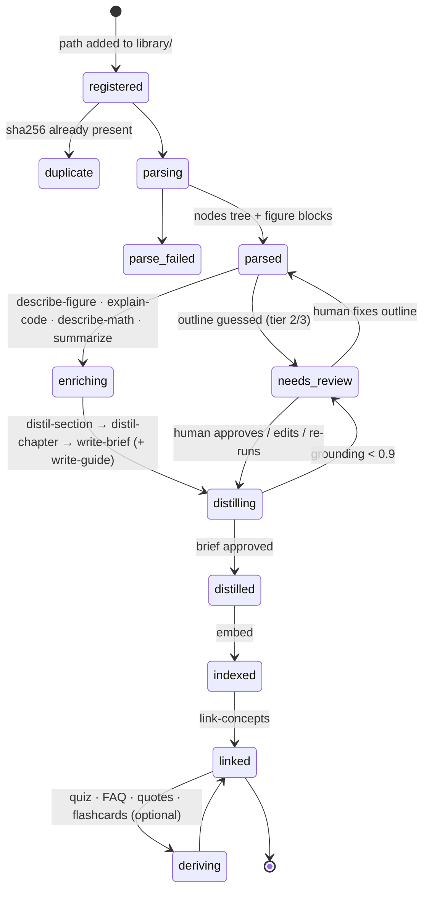

| Stage | Job | Input | Output | Tier (D16) | Human touchpoint |
|---|---|---|---|---|---|
| 1 | `parse` | original file | `nodes` tree incl. `figure` blocks | none (Python) | fix chapter boundaries if the outline was guessed |
| 2 | `describe_figure` · `explain_code` · `describe_math` · `explain_table` | one non-prose block + caption + ±2 blocks | per-kind explanation artifact (§8) | explore, vision where needed | flag misread charts / mis-split tables |
| 3 | `summarize` | one chapter's blocks | `chapter_summary` (short) | explore | — |
| 4 | `distil_section` | one section's blocks (+ figure descriptions) | `section_note` | distil | — |
| 5 | `distil_chapter` | that chapter's section notes | `chapter_distillation` | distil | review & approve |
| 6 | `brief` | all chapter distillations | `book_brief` (+ cross-chapter dedup) | reason | review & approve |
| 7 | `structure_note` | one raw note + its anchor context | `structured_note` | explore | edit; raw never touched |
| 8 | `embed` | blocks + approved artifacts | Qdrant points | none | — |
| 9 | `link_concepts` | approved artifacts | `concepts` + `edges` | reason | merge duplicate concepts |
| 10 | `derive` | approved distillations | `quiz` · `faq` · `quote_set` · `flashcards` · `glossary` | distil | approve |
| 11 | `export` | tree + approved artifacts | `.md` · `.json` · `.csv` bundle | none | — |

Stages 5 and 6 only ever consume **approved** output from the stage below when a human has
reviewed it; otherwise they consume drafts and mark their own output `draft` too. Approval
propagates upward, so a corrected section note invalidates the chapter distillation above it
(same `input_hash` mechanism, new hash → re-run).

### Python vs. skill: who does what

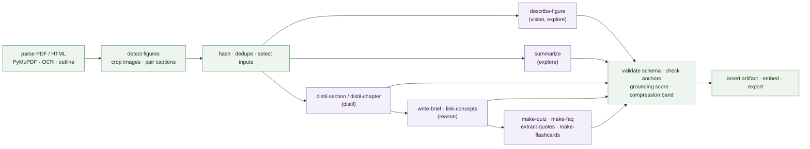

Python owns everything deterministic: parsing, hashing, input selection, validation, storage.
Skills own everything that needs judgement. The boundary is a JSON document in both directions,
so a skill can be swapped, versioned, or run by hand without touching the pipeline.

### The skill contract

A skill is a directory in the repo, not a prompt buried in Python:

```
skills/
  distil-chapter/
    SKILL.md          # the prompt: role, method, hard rules, few-shot
    schema.json       # JSON Schema the output must satisfy
    meta.yaml         # version, tier, model, max_tokens, inputs selector, output type
```

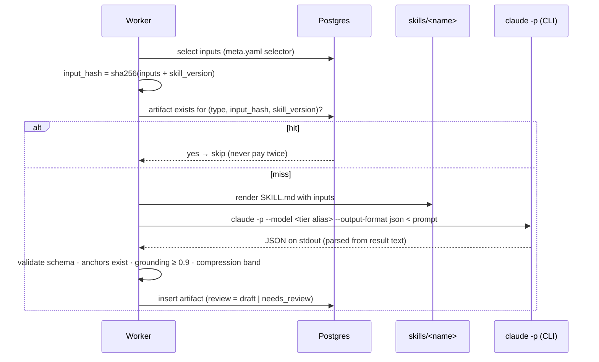

A prompt change means a version bump, which changes `input_hash`, which queues re-runs of
exactly the affected scopes. Prompt iteration becomes a reviewable diff with a measurable effect.

### No API key: the CLI is the model runtime

There is no Anthropic API integration in the backend. Skills run through Claude Code, in one of
two modes, and both land in the same `artifacts` table:

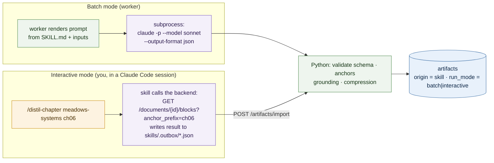

**Batch mode** is for bulk work: the worker shells out to `claude -p` with the rendered prompt on
stdin, `--model` set from the tier alias, and `--output-format json`. The result text is parsed as
JSON and pushed through the same gates as anything else. Concurrency is capped (2–3 processes);
the CLI shares your subscription's rate limits. Every call still leaves a `model_runs` row
(tokens, cache, reported cost, time) for the statistics in §14.

**Interactive mode** is for exploration and hard cases: you open a Claude Code session in the
repo and invoke a skill by name. The skill reads inputs from the local API, works with you, and
drops a JSON file in `skills/.outbox/`. A tiny import endpoint (or `pnpm import-artifacts`)
validates it and inserts it. This is where the "cheap models for exploration" idea actually
lives: `/model haiku` in the session, poke at a chapter, promote what's good.

Consequences:

- `SKILL.md` must read as a Claude Code skill (frontmatter, `$ARGUMENTS`), and also render as a
  bare prompt for `-p`. One file, two entry points; the runner strips the frontmatter.
- Structured output is enforced after the fact by `schema.json`, not by the runtime. Skills end
  with "output only the JSON object", and the runner retries once on a parse failure.
- Vision (`describe-figure`) works in both modes: the CLI reads the cropped PNG path from the
  prompt.
- Swapping in the API later is one adapter (`ModelRunner` protocol: `run(prompt, tier) -> str`),
  same as the source store.

### Skill and artifact catalogue

| Skill | Artifact type | Scope | Tier | Output shape |
|---|---|---|---|---|
| `parse-outline` | outline override | document | explore | `{chapters: [{title, page_from, page_to}]}` |
| `describe-figure` | `figure_description` | figure block | explore (vision) | `caption`, `kind` (chart\|diagram\|table\|photo), `data` as `table` or `chart` block, `takeaway` span |
| `explain-code` | `code_explanation` | code block | explore | `purpose` paragraph, `concepts[]`, `pitfalls` as `callout antipattern`, cites listing anchor |
| `describe-math` | `math_description` | math block | explore (vision) | `latex`, `meaning` paragraph, `symbols[]` as `definition` blocks |
| `explain-table` | `table_explanation` | table block (large or uncaptioned) | explore | one `paragraph` "what it shows" + `takeaway` |
| `summarize` | `chapter_summary` · `book_summary` | chapter · document | explore | 3–5 `paragraph` blocks, ≤ 150 words |
| `distil-section` | `section_note` | section | distil | render blocks, every span cited |
| `distil-chapter` | `chapter_distillation` | chapter | distil | render blocks incl. `callout` tones `important` `remember` `antipattern` |
| `write-brief` | `book_brief` | document | reason | fixed one-page shape (§9) |
| `write-guide` | `book_guide` | document | reason | the in-depth, visual guide (§9): four block sections + `journey`, `themes`, `numbers` |
| `structure-note` | `structured_note` | note | explore | render blocks + `concepts[]`, cites the highlighted anchor |
| `link-concepts` | concepts + edges | document | reason | `{concepts: [...], edges: [{src, dst, relation, evidence[]}]}` |
| `extract-quotes` | `quote_set` | chapter · document | distil | `quote` blocks with `page` |
| `make-faq` | `faq` | chapter · document | distil | `[{question, answer_spans[]}]` |
| `make-quiz` | `quiz` | chapter · document | distil | `[{question, choices[], answer, cites[]}]` |
| `make-flashcards` | `flashcards` | chapter · document | distil | `[{front, back, cites[]}]` |
| `make-glossary` | `glossary` | document | distil | `definition` blocks |
| `mark-salience` | `salience_marks` | chapter | distil | `{marks: [{tier: core · key · term, text, cites: [one anchor], why}]}`, `text` verbatim from the cited block (`verbatim` gate); read by the reader's "Mark what matters" mode |
| `grade-recall` | — (utility: `recall_grades` + `review_items`) | chapter | distil | `{ideas: [{id, status: recalled · partial · missed, feedback, cue?}], question: {idea, text} \| null, comparison: {predicted, argues, ideas} \| null}`; grades by idea id, Python maps ids to cites (§9 "Remembering it") |
| `write-audio-summary` | `audio_summary` | document | reason | a spoken script: `{title, speakers[1–4], sections: [{title, turns: [{speaker, text, cites}]}]}`, per run `params` minutes · format · language (§9 "Audio summaries") |
| `catalogue-document` | `catalogue_entry` | document | explore | the library card: `{theme: {name, new}, subjects[], form, audience, level, description, facts: {publisher, published, edition, isbn, language, series}, cites[]}`; reuses the shelf's themes (`existing_themes`); read where shown (`app/pipeline/catalogue.py`), never copied onto `documents` |

The four study skills marked *chapter · document* are one package each: a job with an anchor
reads that chapter's input (`selector`), a job without one reads the whole book through
`document_selector`. Book-wide quizzes, FAQs and flashcards read every chapter distillation
plus the brief's thesis and ideas and the guide's themes (`document_distillations`), so they
test the book's argument and its cross-chapter links; book-wide quotes read each chapter's
quote set and the source passages its distillation's callouts cite (`document_quotes`),
because the whole source is too long for one prompt and quotes must stay verbatim.

Tier → model mapping lives in one place (`backend/app/pipeline/models.py`) and is the only file
that names CLI model aliases:

| Tier | `claude --model` | Used for | Why |
|---|---|---|---|
| `explore` | `haiku` | summaries, figure descriptions, note structuring, outline guessing, query intent | High volume, low stakes, fast; output is either disposable or human-edited |
| `distil` | `sonnet` | section/chapter distillations, derived artifacts | The bulk of the work; needs faithfulness more than depth |
| `reason` | `opus` | book brief, concept linking, concept merge confirmation | Sees the whole book at once; mistakes here propagate everywhere |

Aliases resolve to whatever the CLI currently maps them to; the resolved model name is read from
the CLI's JSON result and stored in `artifacts.model`, so promoting a skill up a tier is a
one-line change whose effect on grounding score you can read off the `artifacts` table.

`BOOKSHELF_MODEL_EXPLORE` / `BOOKSHELF_MODEL_DISTIL` / `BOOKSHELF_MODEL_REASON` override a rung
per deployment without touching code (e.g. a whole book on `haiku` for a cheap first pass), and
`BOOKSHELF_EFFORT_EXPLORE` / `_DISTIL` / `_REASON` set how hard each rung thinks (`claude --effort`:
`low`, `medium`, `high`, `xhigh`, `max`; every rung defaults to `medium`). An
unknown effort fails at startup, because the CLI itself only warns and falls back. Neither model
nor effort is part of `input_hash`, so artifacts made with other settings stay live; force a
re-run to redo them.

---

## 8. Parsing: a three-tier ladder

The single hardest part, and the one most likely to be over-engineered. Rule: use the cheapest
tier that produces a usable tree, and let the human fix the rest.

| Tier | Tool | When | Output quality |
|---|---|---|---|
| 1 | PyMuPDF: embedded outline + text blocks with coordinates | PDF has a ToC and a text layer — most real books | Good. Chapters exact, sections exact |
| 2 | Tier 1 minus outline: heading detection from font-size/weight clustering, then ToC-page parsing | Text layer but no outline | Decent. Chapter boundaries usually right, sections sometimes merged |
| 3 | OCR (`ocrmypdf`/Tesseract), then tier 2; vision model per page only where layout is broken | Scanned books, heavy multi-column, tables as images | Acceptable. Always lands in `needs_review` |

Decision rule, applied automatically at ingest:

```
text_chars_per_page < 200          → tier 3 (scanned)
has embedded outline               → tier 1
else                               → tier 2
```

Cross-tier rules that matter more than the tier choice:

- **Reading order before prose.** Multi-column pages get sorted by column, not by y-coordinate,
  or every downstream stage inherits scrambled text.
- **Strip the furniture.** Repeated headers, footers, and page numbers are detected by
  cross-page repetition and dropped before hashing.
- **Keep tables as tables.** A table becomes one block with `meta.table = {header, rows}`, never
  flattened prose.
- **Footnotes are attached, not inlined.** `meta.footnotes` on the owning block.
- **Manual fix-up is a first-class feature, not an admission of failure.** A small editor to
  merge/split/rename chapters, saved as an outline override that survives re-parsing.

### Non-prose content: charts, pictures, code, tables, math (D17)

A book is not only paragraphs. Every non-prose element becomes its own block kind with its own
anchor, so it can be cited, searched, and turned into something. Parsing does the deterministic
half (detect, crop, extract, anchor); a skill does the interpretive half (describe, transcribe,
explain). The split is the same for every kind:

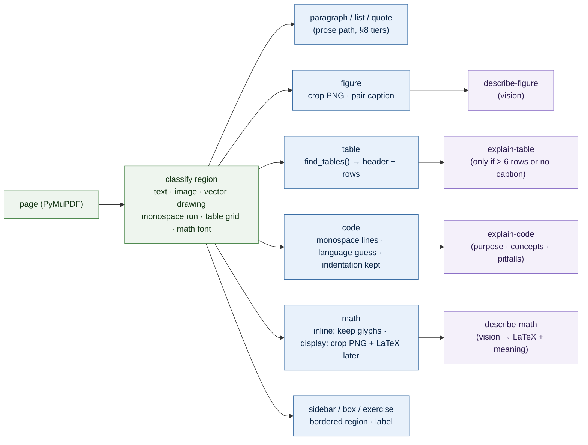

#### Block kinds and what each becomes

| Source element | Detection (Python) | Block kind · `meta` | Skill | Artifact / render block | Downstream use |
|---|---|---|---|---|---|
| **Chart** (bar, line, scatter, pie) | image or vector cluster + caption `Figure N.M`; skill decides `kind` | `figure` · `caption`, `image_path`, `bbox`, `page` | `describe-figure` | `chart {kind, x, series[]}` or `table` fallback, `takeaway`, `confidence` | rendered natively; numbers searchable; quiz asks "what happens to X when Y"; brief cites the curve |
| **Diagram** (flow, system map, 2×2, hierarchy) | same as chart | `figure` | `describe-figure` | `diagram {nodes[], edges[]}` rendered as Mermaid, `takeaway` | edges feed `link-concepts` directly (a systems map *is* a concept graph); flashcards from node definitions |
| **Picture / photo / illustration** | image without axes or arrows | `figure` | `describe-figure` | `paragraph` description, `kind: photo`, `alt` | alt text for reader; embedded for search; rarely cited by distillations |
| **Table** | `page.find_tables()`; fallback: aligned x-coordinates | `table` · `{header, rows, caption}` | `explain-table` (optional) | `table` block verbatim + one `paragraph` "what this table shows" | rendered as table; exported to `tables.csv`; comparisons feed quizzes; rows embedded as text |
| **Code listing** | monospace font run ≥ 2 lines, or `Listing N.M` caption | `code` · `{language, caption, listing_no}` | `explain-code` | `code` block verbatim + `paragraph` purpose + `bullets` concepts + `callout antipattern` if the book shows a bad example | rendered with syntax highlight; runnable snippets exportable per book; quiz "what does this print / what's wrong here"; concept edges `example_of` |
| **Math / formula** | math fonts (CMMI, CMSY, STIX) or display-centered short line | `math` · `{latex?, image_path, inline}` | `describe-math` | `math {latex, meaning}` rendered with KaTeX, `definition` for each symbol | glossary of symbols; flashcards "what does σ stand for here"; searchable by meaning, not glyphs |
| **Sidebar / box / exercise / key takeaway** | bordered or shaded region, or heading like `Exercise`, `Key point`, `Warning` | `aside` · `{label}` | none (prose path) | `callout` with tone inferred from label (`remember`, `caution`, `question`) | exercises become quiz seeds; author's own key points get `important` tone for free |
| **Footnote / endnote** | superscript ref + matching page-bottom run | attached to owning block as `meta.footnotes[]` | none | shown on hover | citations still resolve to the owning anchor |
| **Bibliography / index** | back-matter headings | `part` marked `skip: true` | none | not distilled, not embedded | keeps compression band honest |

#### Rules that hold across kinds

- **Verbatim first, interpretation second.** Tables, code and formulas are stored exactly as
  extracted; the skill's explanation is a separate artifact that cites the block. Nothing
  paraphrases source data.
- **Charts become data, diagrams become structure.** A chart transcribes to numbers you can
  re-plot; a diagram transcribes to nodes and edges you can walk. When axes are unreadable the
  skill falls back to a `table` with what it can read and marks `confidence: low`.
- **Takeaway is cited.** Every description ends with a one-sentence `takeaway` citing the figure
  anchor and the block that introduces it, so a distillation references a figure like any other
  passage.
- **One vision call per element**, never per page. A 300-page book with 40 figures and 20
  formulas costs 60 small calls, not 300 large ones.
- **Code runs nowhere.** Listings are never executed by the pipeline. `explain-code` reads them;
  you copy them.
- **Manual override is normal.** Vector diagrams PyMuPDF can't cluster, tables it splits, code it
  mistakes for prose: all land in `needs_review` with the page rendered as an image. You fix the
  region once; the override is saved like an outline fix and survives re-parsing.

#### What this buys downstream

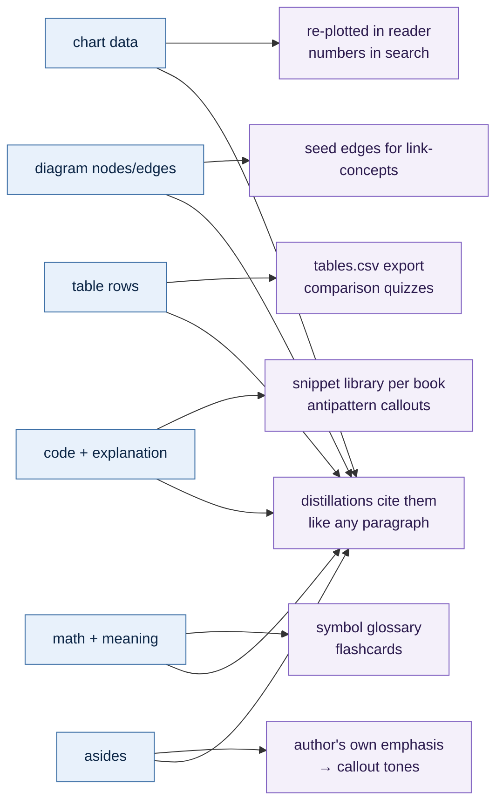

The point is not completeness of extraction. It is that the argument-carrying parts of technical
books are usually *not* in the prose: the systems map, the comparison table, the reference
implementation, the one equation. If those are blocks with anchors, distillations can lean on
them; if they are dropped at parse time, the distillation is of a different, weaker book.

#### Other input formats

| Input | Path to blocks |
|---|---|
| PDF | tiers 1–3 above, plus region classifier |
| EPUB (`.epub`, 2 and 3) | The book's own structure, no layout guessing (`parse/epub`): spine order; nav/NCX entries → tree at their `#fragment` targets (tier 1; none → `h1..h6` rank, tier 2); headings missing from the ToC nest under their entry; `<pre>`, `<table>`, `<figure>`/standalone images, `<blockquote>`, `<aside>` → their kinds; MathML → TeX; footnotes/endnotes lifted into the citing leaf's `meta.footnotes`; figures copied to `.media/` (SVG rasterised to PNG); EPUB 3 `pagebreak`s → print pages; DRM-encrypted content is a parse error |
| HTML article | Readability extraction; `h1..h3` tree; ``/`<figcaption>` → `figure`; `<table>` → `table`; `<pre><code>` → `code` with `class="language-*"`; MathML/`\( \)` → `math` |
| Markdown / notebooks (`.md`, `.ipynb`) | headings → tree; fenced blocks → `code`; pipe tables → `table`; `$$` → `math`; notebook outputs → `figure` |
| Slides (`.pdf` export) | one section per slide; title as heading; everything else through the region classifier |
| Scanned PDF | OCR tier 3; figures/tables via layout only, low confidence by default |

All of them end in the same `nodes` table with the same kinds, so every skill downstream is
format-agnostic.

Articles (HTML) go through the same interface: Readability-style extraction, `h1..h3` as the
tree, `` + `<figcaption>` as figure blocks, treated as a single-chapter document. Same
blocks, same anchors, same distillation.

---

## 9. Distillation

The part that decides whether the system is worth using.

### Summary is not distillation (D14)

| | Summary | Distillation |
|---|---|---|
| Question it answers | What is this chapter about? | What must I retain from it? |
| Length | ≤ 150 words, prose | 25–60 % of the source, structured, in depth (gates: section notes 25–90 %, chapter guides 20–100 %) |
| Keeps | Topic, thesis, scope | Every argument, framework (all its parts), procedure, criterion, definition, model worked example, caveat and figure takeaway; Mermaid `diagram` blocks for the structures the text states |
| Drops | Everything else | Rhetoric, repetition, transitions |
| Tier | explore (Haiku) | distil (Sonnet) |
| Used by | Library cards, search result headers, "should I reread this?" | Reader right pane, brief, quiz/FAQ generation, concept linking |

Both exist for every chapter. The summary is the cheap map; the distillation is the territory
compressed. Generating quizzes or FAQs from a summary produces trivia; from a distillation it
produces something worth answering.

### Who writes distillations (D15)

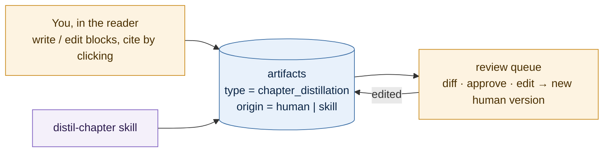

A skill draft you edit becomes a new artifact version with `origin = human`. The skill's version
stays for diffing. Downstream stages (brief, quiz, FAQ) don't care who wrote it; they consume the
approved version.

### Hierarchical, bottom-up, rank-isolated

`section_note` reads only its own blocks. `chapter_distillation` reads only its own section
notes. `book_brief` reads only the chapter distillations. No stage sees its siblings, so no stage
can repeat them — deduplication is structural (D7). The one exception is `write-brief`, which
*does* see all chapters at once and is explicitly tasked with collapsing repeated ideas and
noting where the author circles back.

### Output is structured, not prose

Skills emit a small, closed set of render blocks. This is what makes "tables, bullets, callouts,
highlights" reliable instead of a markdown lottery, and what lets the frontend style everything
consistently:

```jsonc
{
  "blocks": [
    { "type": "heading", "level": 2, "text": "Leverage points" },
    { "type": "paragraph",
      "spans": [ { "text": "Rules outrank parameters.", "cites": ["ch06/s01/p003"] } ] },
    { "type": "callout", "tone": "insight",
      "spans": [ { "text": "Most interventions fail at the weakest leverage point.",
                   "cites": ["ch06/s02/p011"] } ] },
    { "type": "table",
      "header": ["Leverage point", "Power", "Example"],
      "rows": [ [ { "text": "Paradigms", "cites": ["ch06/s09/p002"] }, … ] ] },
    { "type": "quote", "text": "…", "cites": ["ch02/s01/p007"], "page": 34 },
    { "type": "definition", "term": "stock", "spans": [ … ] }
  ]
}
```

Closed block set:

| Block | Purpose | Notes |
|---|---|---|
| `heading` | structure | `level` 2–4 |
| `paragraph` | developed point | `spans[]`, each cited |
| `bullets` · `steps` | lists, ordered or not | items are `spans[]` |
| `table` | comparisons, taxonomies, transcribed chart data | header + rows of cited cells |
| `chart` | quantitative figure transcription | `{kind: bar\|line\|scatter, x, series[]}`; rendered natively |
| `diagram` | flows, systems, hierarchies | `{nodes[], edges[]}`; rendered as Mermaid |
| `callout` | emphasis with a fixed meaning | `tone` = `important` · `remember` · `antipattern` · `insight` · `caution` · `contrast` · `question` |
| `code` | verbatim listing | `{language, text, caption}`; never paraphrased |
| `math` | formula | `{latex, meaning}`; rendered with KaTeX |
| `quote` | verbatim passage | `page` required |
| `definition` | term + cited explanation | feeds the glossary and concept linking |

Callout tones are the "different formats" the LLM output serves: `important` is what the author
insists on, `remember` is what you should be able to recall cold, `antipattern` is what the author
warns against. They render distinctly, filter distinctly (`GET /artifacts?tone=antipattern` across
the shelf is a real query), and map onto flashcards and quizzes without a second prompt.

Nothing else. Adding a twelfth type is a deliberate change to the render contract and the frontend,
in the same commit.

**Every leaf span carries `cites`.** A distillation with uncited claims fails validation (§14).

### Your notes

`structure-note` takes `note.raw` and emits a `structured_note` artifact in the same render
contract — tidied, tagged, linked to concepts, and cited back to the passage you highlighted.
The raw text is never touched and stays visible next to the structured version (D11).

Notes can also mark a passage of the chapter distillation or summary shown in the reader's
pane (`target`, `artifact_id`, `block`, `quote`). The pane paints them with the CSS Custom
Highlight API, so render blocks stay untouched. A newer artifact version leaves the note in
the list ("on an earlier version") with its quote; a deleted artifact leaves it detached.
The reader loads the whole book's notes: the chapter's are shown in place, and the notes
list switches between this chapter and the whole book, grouped by chapter.

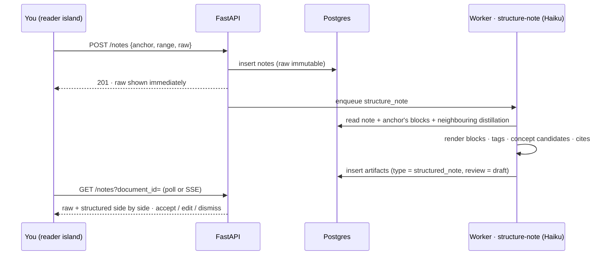

Enrichment is additive: the structured version can add links to concepts already on the shelf
("you wrote about this in Meadows ch.6"), suggested tags, and a cleaned rendering. It never
replaces what you typed, and dismissing it leaves the raw note exactly as it was.

### Format of a brief

One page, fixed shape, so briefs are comparable across books: *thesis in three sentences ·
five to seven load-bearing ideas · the argument's structure · what it changes about how you act ·
where it is weak or dated · read-next pointers into your own shelf*. That last section is the
one only this system can write.

### Format of a book guide

The brief is deliberately one page; the **book guide** (`write-guide`, `book_guide`) is its
in-depth, visual companion: *what a reader needs to grasp the whole book in two minutes, then
learn its core ideas properly*. It reads the same input as the brief (every chapter
distillation) and is queued alongside it as a `derive` job (`skill: write-guide`, deduped with a
manual run by its `skill:<name>` key). Approving it on an already indexed document queues
`embed`, so search sees it; it never gates the pipeline.

| Part | Shape | Drawn on `/documents/{slug}/guide` as |
|---|---|---|
| `overview` | 3–6 paragraphs + an `important` callout | the whole argument, end to end |
| `numbers` | `[{value, label: spans}]` | stat tiles |
| `map` | a `diagram` first | the big-picture Mermaid map of the book |
| `journey` | one `{anchor, role, takeaway}` per chapter | an arc strip (segment = share of reading, colour = role) and timed chapter rows |
| `themes` | `[{name, spans}]`, spans citing every chapter the theme appears in | a theme × chapter heatmap **computed from the cites**, so it cannot claim a chapter it does not cite |
| `deep_dive` | any render blocks under level-2 headings | the core ideas at depth: diagrams, tables, charts, callouts |
| `practice` | `steps` + `antipattern` callout | the book as one playbook |

Reading times come from the document tree (words ÷ 238 wpm), not from the model; rows and
heatmap columns carry the book's own chapter numbers (`ch18` → 18, as cite chips show them), and
front matter and `skip` containers appear only if the guide describes them. A left-to-right map
whose longest chain exceeds five nodes is drawn top-down on the page so its labels stay legible. Roles take the
validated `--series-*` colours in a fixed order; the heatmap uses one hue, light to dark.

### Audio summaries

A book, spoken: `write-audio-summary` writes a script from the same input as the book-wide
study sets (`document_distillations`), and a `narrate` job voices it. The reader chooses
before anything runs:

| Choice | Options | What it changes |
|---|---|---|
| `minutes` | 5 · 15 · 30 | the word budget (~150 spoken words a minute), how many ideas and how deep |
| `format` | narrator (1) · conversation (2) · panel (3) · roundtable (4) | the cast and its roles: explainer and curious co-host, a champion, a practitioner, a skeptic |
| `language` | en · zh | the script's language (VibeVoice speaks English and Mandarin) |
| voices | one per speaker | built-in VibeVoice samples, ones over a music bed, or your own `.wav` in `.audio/voices/custom/` |

`minutes`, `format` and `language` are **run parameters** (`meta.yaml` `params`): they join
the inputs, so each combination has its own `input_hash`, and they name the artifact's
`variant` (`15m-conversation-en`), which joins `(document, anchor, type)` in the version
scope, so one book keeps several episodes, each with its own history. The voices are not
part of the script (speakers are never named in it), so re-casting an episode re-records
it without re-writing it: the same `derive` request with new `voices` is an idempotency
hit whose job still queues a `narrate` with the new cast.

Every turn cites its anchors like any other span (grounding ≥ 0.9); the
`words_per_minute` gate flags a script too short to fill its length or too long to fit
(`pace` in `gates`). Spoken energy lives in the writing, since the voice model takes its
expression from the words: varied turn lengths, reactions, questions, deliberate
punctuation, numbers spelt out.

**Narration** is plain Python around an isolated model: `scripts/narrate/vibevoice.py`
runs through `uv run --script` in its own environment (torch, transformers ≥ 5.17,
diffusers), so the API never imports them, the way skills run through the `claude` CLI
(D18). Each script section is one multi-speaker VibeVoice generation, conditioned on
every speaker's reference clip and the same seed, so voices hold across sections and
turn-taking follows the dialogue; sections are levelled, joined with pauses and written
as MP3 with a manifest of where each section (exact) and turn (estimated) starts. The
first turn opens with a spoken note that the audio is AI-generated. Renders are derived
media on disk (`.audio/<document>/<script>/<render key>.{mp3,json}`, key = cast +
engine settings), never in Postgres; deleting a book deletes them. One narration holds
the whole model in memory, so the API runs `narrate` jobs on a single slot of their own.

**Chapters read aloud.** The same narration reads a chapter (or part, or section) as it is
written: no skill and no rewriting. `app.audio.reading` turns the container's blocks into a
one-reader script of the same shape, each turn citing the block it reads, so the player,
the timeline and the transcript work unchanged. Every heading is said and starts a part;
a part holds whole blocks up to ~220 words (one generation each, so the pace stays even
and the turn times close to exact), and a longer block is split between sentences. Lists
are said item by item, asides with their label, figures by their caption; tables, code,
formulas and `skip` containers are left out, as are note markers, emoji and invisible
characters, and a short paragraph with no closing punctuation (a heading the parser set as
a paragraph) gets a full stop so the voice pauses. `app.audio.sources` is the seam: a
narrate job voices a *source* (`artifact_id` → a summary script, `anchor` → a reading),
each with its body, language, disclosure ("an AI-generated reading of …") and store folder
(`<script id>` or `read~<anchor>`). A reading's render key also hashes its words, so a
re-parse that changes the chapter records anew and only recordings of the current words
are listed. In the reader, Listen (`l`) opens a dock with the player; the passage being
read is marked in the text and followed (unless turned off), and "play from where I am"
starts at the block you are on.

### Remembering it

Reading once is not remembering. Three light habits, each at a moment the reader is already
at, with no screen of its own beyond the Desk's review card:

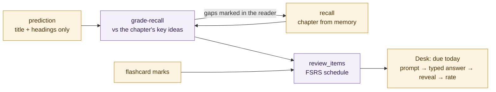

1. **Predict before reading** (pretesting). An unread chapter that can be graded opens on a
   card with only its title and section headings: what do you think it will argue? Saved as a
   `prediction` before the text shows; Escape skips it, a reading setting turns it off.
2. **Closed-book recall** (retrieval practice). At the chapter's end (or `r`) a sheet covers
   the text, which is also hidden and inert, and you write the main claims, evidence and
   examples from memory. Saving queues a `grade_recall` job. The answer key is the chapter's
   **key ideas**: its `salience_marks` core ideas and key points, else its distillation's cited
   spans, numbered `I1, I2…`. `grade-recall` says for each idea *recalled*, *partial* or
   *missed* with one line of feedback, writes a retrieval **cue** for each gap, asks one
   "why is this true?" about an idea you recalled (elaboration), and, when there is a
   prediction, sets it against the thesis ("you predicted X; it argues Y"). The model grades by
   id only; every cite in the grade is the idea's own, so it cannot cite what the chapter does
   not say. "Gaps marked" reopens the chapter with the missed ideas in the core wash and the
   partial ones in the key stroke of the what-matters mode.
3. **Spaced retrieval**. Each gap becomes a review item prompted by its cue and due tomorrow
   (keyed by the idea, so missing it twice keeps one schedule); the why question is due now;
   every flashcard you mark joins too (knew = Good, still learning = Again), marks now live
   server-side instead of in the browser. FSRS (`py-fsrs`, no minute-scale learning steps)
   sets each next date from your self-rating. A review is retrieval, not rereading:
   `GET /reviews/due` carries prompts only, the cited answer is revealed for a typed
   attempt, and the rating logs that attempt.

### Derived artifacts

Once approved distillations exist, everything below is a cheap, separate skill over them. None of
them read the source blocks directly; they read distillations and cite through them, so their
citations are already verified.

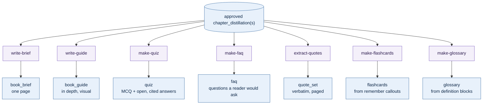

| Artifact | From | Shape | Why it earns a slot |
|---|---|---|---|
| `book_brief` | all chapter distillations | fixed one-page (above) | the thing you reread a year later |
| `book_guide` | all chapter distillations | sections + journey, themes, numbers (above) | understanding the whole book at a glance, then in depth |
| `quiz` | one chapter | `{question, choices[], answer, cites[]}` | active recall; wrong answers link to the passage |
| `faq` | chapter or document | `{question, answer_spans[]}` | how a colleague would ask; good search seed |
| `quote_set` | one chapter | `quote` blocks with `page` | citable verbatim material for your own writing |
| `flashcards` | `remember` callouts + definitions | `{front, back, cites[]}` | spaced repetition: marked cards join the FSRS review queue (§9 "Remembering it") |
| `glossary` | `definition` blocks across the book | `definition` blocks, deduped | feeds concept linking and the graph |

Each is its own skill directory, its own schema, and its own row type, so adding one never
touches another.

---

## 10. Retrieval

### Address before search (D8)

A router classifies each query first:

| Intent | Example | Resolution |
|---|---|---|
| **Addressed** | "summarize chapter 3 of Meadows" | Deterministic tree fetch. No vectors involved |
| **Discovery** | "what do I know about feedback loops?" | Tier-1 search over distillations, then evidence blocks |
| **Synthesis** | "how do Meadows and Senge disagree?" | Multi-document distillation retrieval + `contradicts` edges |
| **Lexical** | "find the exact phrase 'stock and flow'" | Sparse/BM25 only |

Classification is a cheap, cached call with a hard fallback to Discovery. The point is that the
two most common questions — "remind me what this chapter said" and "find the exact wording" —
never touch an embedding model.

### Two-tier hybrid search

Search the **distillation** collection to decide *what* is relevant; search the **blocks**
collection to fetch *evidence* for the chosen scopes. Answers are assembled from dense
distillation prose plus a handful of cited source passages — far less context, far better
answers than top-k over raw chunks.

### Qdrant layout

Three collections. Named vectors must be declared at creation time — changing them later means a
rebuild, which is fine (D1) but worth avoiding:

```
blocks          dense: "text" (bge-small-en-v1.5, 384d, cosine)
                sparse: "bm25"
                payload: document_id, anchor, chapter_no, section_path,
                         kind, tags[], char_len, model_id

distillations   same vector config
                payload: document_id, anchor, type, level, tags[], review, model_id

documents       metadata only, point id = document_id — the join target for `with_lookup`
```

Grounded in the current Qdrant guidance:

- **Payload indexes are created immediately after the collection, before bulk upsert**, so they
  build alongside HNSW: `document_id` (keyword), `chapter_no` (integer), `tags` (keyword),
  `type`/`level`/`review` (keyword).
- **BM25 `avg_len` is tuned per collection.** Blocks are document-length; distillation bodies are
  shorter. Leaving the default on the short collection skews scoring.
- **Grouping by `document_id` with `with_lookup` into `documents`** keeps document metadata in
  one place instead of copying the title onto every point, and stops one verbose book from
  taking every slot in the results.
- **Prefetch sizing**: `prefetch_limit ≥ final_limit × expected_chunks_per_document`, or relevant
  documents drop out during grouping.
- **`model_id` on every point**, so a model swap is detectable and re-embedding is a filtered job
  rather than a full wipe.
- **No quantization** at this corpus size (D12).

Reranking sits above both tiers as a single cross-encoder pass over the merged candidate set —
cheap, and it matters more than any amount of embedding tuning.

Docs relied on: [multi-representation search](https://qdrant.tech/documentation/tutorials-search-engineering/multi-representation-search/) ·
[search groups & lookup](https://qdrant.tech/documentation/concepts/search/) ·
[full-text search](https://qdrant.tech/documentation/concepts/indexing/)

---

## 11. The idea graph

Ambitious in the idea dump ("a big net"); the scoped version is **neighborhoods, not nets**,
plus one chapter-grain map of the whole shelf.

**Nodes**: concepts, blocks, artifacts, documents. **Edges**: the seven relations in §6.
`link-concepts` runs over approved distillations, proposes concepts and edges with evidence
anchors, and every edge records its origin so machine proposals and human curation stay
distinguishable.

**Mention seeds** close the gap `link-concepts` leaves: it ties each concept to the few passages
that define or use it best, so later chapters (and other books) that lean on the same idea never
meet. A deterministic pass (`app.graph.mentions`) scans every block for every live concept's name
and aliases (short names only as capitals, `STAR`, `WIP`; the longest name wins) and links the
*section* to the concept, `section —mentions→ concept`, with the blocks as evidence and a weight
that grows with how often it is named. Blocks the skill already linked are not counted twice.
Mention edges are seeds: re-run on every graph refresh (for every book when concepts come or go,
and after a human renames or merges one), and they never keep a concept alive on their own.

**Semantic links** read what the text *means*, from the vectors already in Qdrant (bge-small,
§10), with no model calls (`app.graph.semantic`, run at the end of every `embed` job):

- `chapter —echoes→ chapter`: one Distance Matrix call (`search_matrix_pairs`) over every block
  gives the shelf's nearest-neighbour graph. A pair *echoes* when it joins two chapters above a
  bar calibrated on the shelf itself, `max(0.84, p95 of cross-chapter pairs)`: bge-small's cosines
  sit in a narrow 0.7 to 0.9 band, and one author's style alone keeps a book's chapters close, so
  a fixed threshold links everything or nothing. Two echoing pairs link two chapters; the
  echoing passages are the evidence. Verbatim repeats and short blocks are ignored.
- `passage —mentions→ concept` for a passage that explains a concept without naming it: each
  concept's name and gloss is one query in a batch (`query_batch_points`); a passage counts above
  0.79 and within 0.07 of the concept's best match.

Measured on the first shelf (1,867 blocks): cross-book passage pairs topped out at 0.77, below
the median of pairs within one book, so the two books rightly got no echo between them.

**Bridges** are the one model-judged link across books (`app.graph.bridges`, skill
`relate-concepts`): concept pairs in no common book whose embeddings are close (0.62 up to the
dedup threshold) are shown to the model with passages from each book, and a relation (supports,
contradicts, extends, example of) comes back citing at least one passage from each. It lands
**proposed**, to accept or reject on the map; `none` is kept as a rejected edge so no pair is
asked twice. New concepts queue a bridge job; `POST /graph/bridges` queues one per book.

**Concept deduplication** — the failure mode that turns a graph into noise: candidate merges come
from embedding similarity above a threshold plus an LLM confirmation, and then land in the review
queue as a proposed `same_as` edge. Merges are applied by a human, never automatically.

**Navigation rules**, which exist to keep the thing usable:

- One focal node at a time; depth ≤ 2; at most 150 nodes rendered.
- Edges ranked by weight × evidence count; the long tail is collapsed behind "show more".
- Every edge in the UI is clickable through to its evidence passages. An edge you can't verify
  is a liability.
- One global view, and a coarse one: the **atlas** (`GET /graph/atlas`). Not every passage
  (that is the useless "show me everything"), but books, the chapters that take part in the
  graph, and concepts, with passage edges folded up to their chapter, `book —contains→ chapter`
  for structure, and a derived `chapter —shares→ chapter` wherever two chapters lean on the same
  concepts (rare concepts bind harder; each chapter keeps its three strongest partners). It is
  read-only and derived on request, and the map built on it has a lens that filters and
  highlights by connection type, kind and book. Everything it shows opens the reader, the
  concept page, or that node's neighbourhood.

Queries are recursive CTEs over the indexed `edges` table (D9).

---

## 12. Frontend

Keep Astro as the shell and routing layer; add React islands only where interaction is real
(D10). Six surfaces:

| Surface | Tech | Why |
|---|---|---|
| **Library** | Astro, server-rendered; one small script (`components/library/live.ts`) | Spines dyed by kind, reading, study material or theme with a colour key, facet bars that filter, grouping behind divider cards, eight orders, a lectern for the picked book (its cover, card and study material), list view, ingest dialog. Filters and order in the URL, display choices in localStorage; everything works without the script |
| **Reader** | React island | Two panes — source blocks left, distillation right — anchor-synced scrolling, highlight/note creation. Reading settings (font, size, spacing, width), panes you can put away, focus mode and full screen, passages colour-coded by role (quote, example, exercise…), all kept per browser. "Mark what matters" (`h`) colours the source itself: core ideas, key points and defined terms, drawn in as each block scrolls into view, each opening a card with why it was marked, and a meter of the key ideas reached. The marks are `mark-salience`'s when that chapter has run it (a manual `derive` per chapter), otherwise inferred from what the distillation, notes and summary cite and from the book's concepts and glossary. Saves your place in the chapter as you read (server-side, so it follows you across devices); the document page offers "Continue reading" and shows progress per chapter and for the book. Listen (`l`) reads the chapter aloud as written, marking and following the passage being read. Recall (`r`, or at the chapter's end) hides the text while you write what you remember, then shows the grade and marks the gaps; an unread chapter first asks what you expect it to argue (§9 "Remembering it"). Genuinely interactive |
| **Desk** | Astro + one React island | The home page; "Due today" runs the spaced reviews across every book inline, one card at a time (prompt, typed answer, reveal, rate 1–4), and is absent when nothing is due |
| **Brief** | Astro, static | Renders one approved artifact. Server-rendered, instant, printable |
| **Guide** | Astro + one React island | The book guide with its charts (arc strip, chapter rows, theme heatmap, stat tiles), server-rendered then hydrated: a cite, chapter title or heatmap cell opens the passage in place (a drawer with the whole chapter, the cited block marked, previous / next chapter, "Open in reader"; its left edge drags wider with the reader's own width grip, and its width and typography are the reader's saved preferences); diagrams and charts magnify in the reader's lightbox. ⌘/Ctrl/middle click still opens the reader |
| **Search** | React island | Query box, intent badge, grouped results, cited answer with click-through |
| **Graph** | React island | Canvas force layout over a neighborhood endpoint, node cap enforced client-side |
| **Map** | React island | The atlas as a live force layout: books, chapters and concepts; select to read, double-click to open. A lens mode filters and highlights by connection type, kind and book, dims or hides the rest, groups by book, and shows proposed bridges to accept or reject. A path finder traces the strongest chain between two marks, hop by hop, each hop opening its evidence |
| **Listen** | Astro + one React island | Audio summaries: pick an episode and cast, a player (skip, speed, parts, download, resume where you stopped, Media Session and keys), a transcript that follows the audio and links each line to its passage, and the form that makes an episode |
| **Review queue** | React island | Draft artifacts, diff against the previous version, approve / edit / reject / re-run |
| **Papers** | Astro + islands | Paper shelf, paper tabs (card · explain · claims · results · references · notation · review · club), reading queue, compare, sets, three-pass reader mode ([PAPERS.md](PAPERS.md) §8) |
| **You** | Astro + React islands | Reader statistics (§12 "Reader statistics"): `/you` for the shelf, `/you/{slug}` for one book, with a window (7 / 30 / 90 days, a year, all time) |

### Reader statistics

The pipeline statistics (§14) describe the machine; these describe the reader: how long you
read, listen and study, when and in what sittings, how far and how deep you go with each book,
the chapters and passages you spend longest on, your notes, and what you remember.

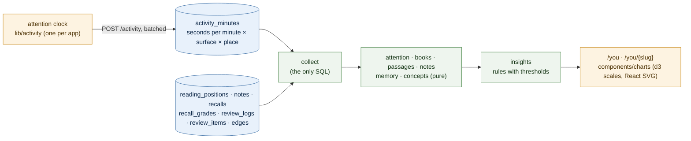

- **Capture.** Time is the one thing no other table records, so the browser keeps an attention
  clock (`frontend/src/lib/activity`): pages say where attention is (`useAttention`, or
  `<ActivityBeacon>` on pages without an island), and a 5 s tick counts it only while the page
  is visible and was touched in the last two minutes. Audio counts itself while it actually
  plays (`NowPlaying`), on any page. Reports go out every minute and on `pagehide`, batched
  per minute and place; the server adds them to `activity_minutes`, never above 60 s a row
  (migration `20260928105421_activity_minutes`). Surfaces: `read` (the block being read),
  `listen`, `study`, `recall`, `review`, `distill` (brief, guide), `explore` (search, graph,
  map, concepts). Listening while following the text counts for both.
- **History.** Everything but time comes from rows the app already writes, so it covers the
  whole history; time starts at `tracked_since`. A moved reading place, a note, a recall or a
  review makes a day active even without tracked time.
- **Figures.** Time by surface, day (calendar) and weekday × hour; *sittings* (no break over
  ten minutes, any surface), their lengths and streaks; per book: progress by words, state
  (unread, reading, stalled after 21 days, finished), depth (opened → read a quarter →
  annotated → recalled → reviewed), notes per 1k words read, retention; per chapter: time,
  distinct days, words per minute (only chapters with two minutes of reading and some progress)
  and *pace*, your usual speed over the chapter's; the passages with the most time and the most
  notes; note colors, targets and lengths; recall scores over time and idea statuses; review
  ratings, card states and the next fourteen days due; the concepts mentioned by passages you
  spent time on or annotated.
- **Insights** (`app/reader_stats/insights/`) are rules in three files (habits, progress and
  focus, notes and memory) with `Thresholds`: peak hours and weekday, streaks, short sittings,
  stalled and nearly finished books, slow and skimmed chapters, a passage you keep returning
  to, chapters finished without notes or a recall, missed ideas, due backlogs and retention.
  Each links to where to act on it.
- **Charts** live in `frontend/src/components/charts` as reusable React SVG components with
  d3 for scales and layout (calendar heatmap, stacked columns, weekday × hour grid, share bar,
  ranked bars, line, scatter, treemap, session strip), colored by theme tokens, each with a
  tooltip, a keyboard path and a legend. `components/you/model.ts` turns the API's shapes into
  their inputs.

The render contract (§9) is implemented once as a `<Blocks>` component and reused by reader,
brief, search results, and notes. Highlight colors, callout tones, and table styling live there
and nowhere else.

**The review queue is not optional.** It is the difference between a knowledge base you trust and
a pile of plausible AI text. It ships in phase 1, with the first distillation.

---

## 13. API surface

```
POST   /documents                      ingest {path: 'library/x.pdf'} | {url}   → 202 + job
GET    /library                        files in library/ not yet ingested
GET    /documents                      list, filter by tag/status/author
GET    /documents/{id}                 metadata + pipeline state
GET    /documents/{id}/tree            outline; ?depth=, ?include=blocks
PATCH  /documents/{id}/outline         manual chapter/section fix-up
POST   /documents/{id}/outline/confirm accept a guessed outline as is (needs_review → parsed)
POST   /documents/{id}/resume          lift a run-ceiling pause {max_runs?}
GET    /documents/{id}/blocks          paginated, ?anchor_prefix=

GET    /documents/{id}/reading         reading positions, most recently read first
PUT    /documents/{id}/reading         save a chapter's position {unit, anchor, progress}

POST   /documents/{id}/recalls         write a recall (→ grade_recall job) or a prediction {unit, kind, raw}
GET    /documents/{id}/recalls?unit=   recalls and predictions with their grades, newest first
POST   /documents/{id}/recalls/{rid}/grade  grade a recall again → 202 + job

GET    /reviews/due?limit=             review prompts due now across every book (no answers)
POST   /reviews/{id}/reveal            the cited answer, for a typed attempt {answer}
POST   /reviews/{id}/rating            log the attempt and rate it {rating 1–4, answer}; FSRS reschedules
GET    /reviews/flashcards/{artifact}  your marks on a deck
PUT    /reviews/flashcards/{artifact}/{index}  mark a card {mark: knew | learning}
DELETE /reviews/flashcards/{artifact}  forget the deck's marks (and its queued cards)

GET    /nodes/{document_id}/{anchor}   one block or subtree

POST   /notes                          create highlight (no raw) or note (raw → structure_note)
PATCH  /notes/{id}                     color; raw once, for a highlight
GET    /notes?document_id=&anchor=

GET    /artifacts?document_id=&type=&review=&tone=&latest=
POST   /artifacts                      human-authored artifact (origin = human)
POST   /artifacts/{id}/review          approve | reject | edit | reopen
POST   /jobs                           enqueue {kind, document_id, anchor?, skill?, note_id?, force?,
                                                params?, voices?, artifact_id?}
GET    /jobs?state=&kind=              queue view for the review UI
GET    /jobs/stream                    SSE: job state changes
DELETE /jobs/{id}                      cancel a queued job
POST   /jobs/{id}/retry                re-queue a failed job

POST   /search                         {query, mode?, filters?}  → grouped results (+ relations)
POST   /search/answer                  SSE: cited answer
GET    /concepts?q=&sort=              typeahead, edge_count
GET    /graph/neighborhood?node=&depth=
GET    /graph/atlas?include_proposed=  the whole shelf at chapter grain (map)
POST   /graph/bridges                  queue relate-concepts bridge jobs {document_id?}
GET    /audio/voices                   voices to cast, speakers per format, default casts
GET    /audio/voices/{id}/sample       hear a voice (its reference clip)
GET    /documents/{ref}/audio          episodes: per variant, the script and its renders
GET    /documents/{ref}/audio/read/{anchor}  a chapter read aloud: its script and recordings
GET    /audio/files/{path}?download=   stream (byte ranges) or download a narration
GET    /exports/{document_id}.md       Markdown bundle
GET    /exports/{document_id}.json     tree + approved artifacts, render-contract JSON
GET    /exports/{document_id}/tables.csv  every table/chart block flattened
POST   /activity                       seconds of attention per minute and place {entries: [...]}
GET    /reader-stats?tz=&days=         reader statistics across the shelf (§12)
GET    /documents/{ref}/reader-stats   the same for one book
GET    /stats                          pipeline statistics for every book, skill and model (§14)
GET    /documents/{ref}/stats          one book: passes, stages, chapters, skills, insights
```

Paper endpoints (`/papers…`, `/claims…`, `/paper-sets…`) are listed in [PAPERS.md](PAPERS.md) §7.
All of it sits behind the existing `/api/v1` prefix, error envelope, and API-key guard on writes.
Ingest and job endpoints return `202` with a job id; the frontend polls `/jobs`.

---

## 14. Quality gates

The guardrails that matter here are about **truthfulness of generated content**, layered on top
of the transport-level guardrails already in `backend/`.

| Gate | Mechanism | On failure |
|---|---|---|
| **Schema** | Output validated against the skill's `schema.json` | Retry once, then `failed` |
| **Grounding** | Share of leaf spans carrying ≥1 valid `cites` anchor | < 0.9 → `needs_review` |
| **Anchor validity** | Every cited anchor exists in this document; and (skills only) lies in the scope's subtree or appears in the skill's inputs | Nonexistent: reject, re-run. Existing but never shown: flag `out_of_scope_cites` → `needs_review` |
| **Compression** | Length vs. source within the type's band: summary ≤ 150 words, distillation 25–90 % (chapter 20–100 %) | Outside → flag (too long = copying, too short = skipping) |
| **Non-prose confidence** | per-kind skills self-report `confidence`; chart data needs ≥ 2 points, code must round-trip byte-identical, LaTeX must parse | `low` → `needs_review`, never cited by distillations until approved |
| **Human bypass** | `origin = human` skips grounding and compression, keeps schema + anchor validity | Reject only on invalid anchors |
| **Duplication** | Similarity between sibling distillations | Above threshold → flag for the brief's dedup pass |
| **Run ceiling** | Per-document count of CLI runs and wall-clock, tracked in `jobs` | Pause the document, surface in the queue |
| **Idempotency** | `(type, input_hash, skill_version)` unique | Skip; never pay twice |

Grounding score is the important one: it turns "does the AI make things up?" from a vibe into a
number you can watch across prompt versions.

### Pipeline statistics

The gates say whether one output is good; the statistics say where the pipeline spends its
tokens and minutes, and which skill to improve next. `app/telemetry` captures, `app/stats`
computes, and `/pipeline/stats` (library) and `/pipeline/stats/{slug}` (one book) in the workshop show it.

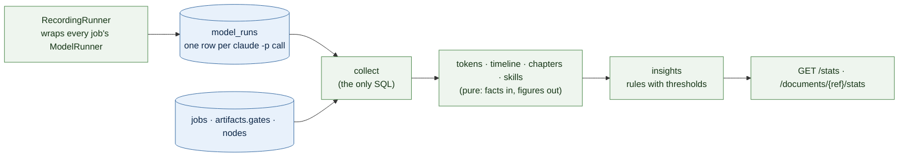

- **Capture.** Handlers wrap the CLI runner in `recorded(...)`, so every call, including schema
  retries, failed attempts and each dedup verdict, writes a `model_runs` row in its own short
  session: input, output and cache tokens, the CLI's `total_cost_usd`, wall and API time, prompt
  size (migration `20260928100300_model_runs`). A failed job still leaves the tokens it burned
  on record. If a telemetry write fails, it is logged and dropped, never failing the job.
- **History.** Jobs from before per-call telemetry still count, through `jobs.cost_tokens`,
  `duration_ms` and `result.model`. Cache, cost and wasted tokens start with the first
  recorded call (`telemetry_since`).
- **Three clocks.** *Wall* (first job queued → last finished), *active* (at least one job
  running), *compute* (sum of run times); compute / active is the parallelism the slots
  achieved. A **pass** is a burst of jobs no more than 30 minutes apart. The first pass that
  parsed the book is its end-to-end run, drawn stage by stage with the stretches each stage was
  actually busy.
- **Per chapter.** Any anchor belongs to its longest chapter prefix. Tokens and compute are
  divided by the chapter's words and pages, so outliers show whatever the chapter length
  (usually a mis-split outline or heavy figures).
- **Per skill.** Failure rate and top error signature, second-try rate (`gates.schema_retry`),
  repair rate, gate-flag rate and top flag, grounding mean and min, p50/p95 duration, tokens
  per job and per output word, cache-hit rate (idempotent skips). These are the figures a
  version bump should move.
- **Insights** are rules (`app/stats/insights/`) over those figures with tunable
  `Thresholds` and minimum samples: a failing or slow skill, frequent retries, repairs or
  flags, weak grounding, a clean expensive skill that may hold up one tier cheaper (D16), a cost
  driver, wasted tokens, low parallelism or long queue waits, and outlier chapters and books.
  Each one carries the metric and value that triggered it.

---

## 15. Phases

Each phase ends with something usable on its own.

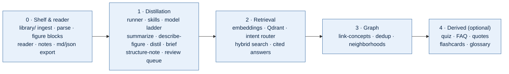

**Phase 0 — Shelf & reader** *(no AI at all)*
Drop a PDF in `library/`, parse tiers 1–2 including figure blocks with cropped images, browse the
tree, read blocks in the reader, highlight, write raw notes, export Markdown and JSON. Rename
`books` → `documents`, add `nodes` and `notes`, move to Supabase Postgres.
*Done when*: you can drop in a PDF and read it in the app with your highlights and figures.

**Phase 1 — Distillation**
Job runner, skill loader, model ladder, `summarize` and `describe-figure` (Haiku),
`distil-section` → `distil-chapter` (Sonnet) → `write-brief` (Opus), `structure-note`, render
contract incl. `chart`/`diagram`/callout tones, human-authored artifacts, review queue, grounding
score.
*Done when*: a book yields chapter summaries, chapter distillations that include its figures, and
a one-page brief you'd actually reread.

**Phase 2 — Retrieval**
Embeddings, the three Qdrant collections, intent router, two-tier hybrid search, reranking,
cited answers.
*Done when*: "what do I know about X" returns a cited answer across books.

**Phase 3 — Graph**
`link-concepts`, concept dedup with human merge, neighborhood endpoint and view.
*Done when*: you can start at a concept and walk to passages in three different books.

**Phase 4 — Derived artifacts** *(optional, cheap once 1–3 exist)*
`make-quiz`, `make-faq`, `extract-quotes`, `make-flashcards`, `make-glossary`, spaced-repetition
review. Same skill runner, same review queue, same citations. No new architecture.

---

## 16. Open questions

| # | Question | Recommendation |
|---|---|---|
| 1 | Postgres now or at phase 1? | **Settled: now.** Arrays, JSONB, FTS and `SKIP LOCKED` are used from phase 0 (§18) |
| 2 | Which embedding model? | `bge-small-en-v1.5` via FastEmbed locally — free, fast, good enough at this scale. `model_id` on every point makes a later swap a filtered re-embed |
| 3 | Job queue? | **Settled: the `jobs` table itself**, claimed with `FOR UPDATE SKIP LOCKED` — no Redis to run (§18) |
| 4 | Distillation model? | Settled as the three-tier ladder (D16) over CLI aliases `haiku` / `sonnet` / `opus` (D18). Resolved model recorded per artifact, so promotions are measurable |
| 9 | Does `claude -p` hold up for 100+ jobs per book? | Unknown until tried. Mitigations: cap at 2–3 concurrent processes, cache aggressively by `input_hash`, run heavy stages overnight. If it doesn't, the `ModelRunner` seam is where the API goes |
| 5 | Where do exports live? | `exports/` next to `library/`, gitignored, regenerated on approval. Never read back as input (D2) |
| 6 | Multi-language books? | Defer. Record `language`, keep BM25 tokenization configurable, do nothing else until a non-English book actually arrives |
| 7 | Figures, code, math? | Settled (D17): phase 0 classifies regions and anchors them, phase 1 per-kind skills explain them. Open: vector diagrams PyMuPDF can't cluster, and math without a LaTeX source — vision + manual override for now |
| 8 | PDFs in git? | `library/` with git-lfs if the repo is shared, plain gitignore if not. Decide when the second machine appears |

---

## 17. Risks

| Risk | Mitigation |
|---|---|
| Parsing quality caps everything downstream | Tier ladder plus a manual fix-up UI; treat `needs_review` as normal, not as failure |
| Distillations that read well but say nothing | Grounding score, compression band, and a human approval step before anything is indexed |
| Concept graph degenerates into noise | Human-confirmed merges only; evidence required on every edge; neighborhoods, not a global net |
| Scope creep into video/quiz/extras before the core works | Phases 0–3 are the product; phase 4 is explicitly optional (§1) |
| Prompt drift making old artifacts incomparable | Skill versions on every artifact; re-runs are diffs, not overwrites |

---

## 18. Implementation notes & deviations

The design above is a guideline. Where the build diverged, the reason is recorded here.

| Area | Planned | Built | Why |
|---|---|---|---|
| Job queue | `arq` on Redis | `jobs` table as the queue: `claim()` = `UPDATE … WHERE id = (SELECT … FOR UPDATE SKIP LOCKED)`, exponential backoff, stale-lock reclaim (a live worker heartbeats its running jobs' locks, so only a dead worker's job is reclaimed), partial unique index dedupes *queued* work, and `claim()` holds a queued job back while an identical one runs, so a re-run requested mid-run waits instead of being dropped (migration `20260924023412_dedupe_queued_only`) | One less service; the queue state *is* the domain state the review UI shows (`app/jobs/queue.py`) |
| Database timing | SQLite in phase 0 | Postgres from the start; schema in `supabase/migrations/`, applied to Supabase via MCP and locally by `python -m app.db.migrate` | JSONB, `text[]`, FTS and `SKIP LOCKED` are needed immediately; one SQL source for both targets |
| Dev database | — | `scripts/pg-local.sh`: isolated cluster in `.pgdata/` on port 54329, trust auth on localhost; tests create a throwaway DB per process | No passwords, no collision with a system Postgres, parallel test runs never share state |
| Notes ↔ nodes | notes FK to nodes | notes reference only `documents`; re-parse upserts nodes by anchor; a note whose anchor vanished is shown as *detached* | A cascading FK let a re-parse delete notes, violating D11 |
| D11 enforcement | API rule | plus a `before update` trigger rejecting any change to `notes.raw` | Defence in depth for the one irreplaceable artifact |
| Schema additions | — | `jobs`: `payload`, `priority`, `run_after`, `locked_at`, `max_attempts`, `result`; `artifacts`: `note_id`, `gates`, `reviewed_at`, review state `needs_review`; `edges.status` (proposed/accepted/rejected); `concepts.merged_into`, `blurb_cites`; `documents`: `parse_tier`, `outline_override`, `meta`, `updated_at` | Queue mechanics, gate trend lines, human-confirmed merges, outline fix-ups that survive re-parsing |
| Lexical search | Qdrant BM25 only | plus a generated `tsvector` on `nodes` for exact-phrase queries (`phraseto_tsquery`) | BM25 ranks terms; it cannot answer "find the exact phrase" |
| Supabase exposure | — | RLS enabled with no policies and all grants revoked from `anon`/`authenticated`; the backend connects as owner | The Data API is not used; deny it everything |
| Qdrant runtime | cluster | `BOOKSHELF_QDRANT_URL` set → cluster; unset → embedded on-disk store in `.qdrant/` | Same code path for dev, tests and production |
| Frontend writes | browser → API with key | browser → Astro same-origin proxy (`/api/*`) that injects `X-API-Key` server-side | The key never reaches the browser |

| EPUB | out of scope | parsed from its XHTML and table of contents, not reflowed through the PDF pipeline; kind `epub`; no outline editor (the outline is the book's own, and overrides are page-based) | Reflowing through MuPDF gave synthetic pages and misread whole pages as boxes; the markup already says what every block is (`parse/epub`) |
| Tier-3 detection | `text_chars_per_page < 200` → OCR | plus page-sized image coverage: a sparse page is OCR'd only when an image covers most of it | Slides and diagram pages are sparse but digital; OCR'ing them destroyed good text (`parse/pdf`) |
| Outline override | stored override, re-parse | the override *replaces* detected boundaries and clears `needs_review` (a human has decided); one shape for API and parser (`app/schemas/outline.py`: `page_to` optional, `skip`, no overlapping chapters); the re-parse job's `input_hash` comes from the override, and a parse whose override changed meanwhile discards its tree; `POST /documents/{ref}/outline/confirm` accepts a guessed outline unedited | The fix-up loop had to be lossless under concurrency and not force an edit just to say "looks right" |
| Back matter | — | text after the last override chapter's `page_to` becomes a trailing `Back matter` container marked `skip`; bibliography/index containers are `skip` too and invisible to every selector | Not distilled, not summarized, still readable in the reader |
| Chapter intros | distil sections, then chapters | leaves directly under a chapter that also has sections get a `section_note` on the chapter's own anchor (rank-isolated: only those leaves); it feeds `chapter_section_notes` first | Otherwise intro paragraphs were in no note at all |
| Stage barriers | §7 order | element explanations (figure/code/math/table) gate section notes: `distil_section` is queued only once no element job of the document is live (failed or cancelled ones release the barrier too) | Section notes cite element takeaways; running them earlier means paying twice |
| Forced re-runs | new `input_hash` → new version | `force` re-runs the same input and rejects the previous live artifact for it (the idempotency index allows one) | "never pay twice" stays a database invariant even for deliberate re-runs |
| Compression gate | length vs. source | output words ÷ words of the scope's *source leaves* (element skills: the element's text or caption), not of the inputs incl. prior artifacts | A chapter distillation built from section notes would otherwise be judged against the notes |
| Review reopen | approve / reject / edit | plus `reopen` (approved/rejected → draft; 409 if another live row covers the input). Nothing built on the verdict is withdrawn; reopened `concept_links` re-sync the graph; reopened approved content on an indexed document queues `embed` so search (approved only) drops it | Undo without cascading deletes; search and graph never show what a human took back |
| Superseded versions | append-only versions | list items carry `superseded` (a newer non-rejected version of the scope exists), `GET /artifacts?latest=true` hides them; no schema change | A human edit must retire the draft it replaced from the review queue |
| Run ceiling | pause the document | `documents.meta.paused = {reason, at, runs, limit}` shown as `paused` on documents; skill jobs of a paused document fail before any model call (`run ceiling reached…`); `POST /documents/{ref}/resume` clears it, sets `meta.run_ceiling`, requeues what it stopped; ceiling failures are not runs; every CLI run (schema retries, failed attempts, each dedup verdict) is reserved before it starts under a lock on the document row and counted in `jobs.result.runs` | Visible and recoverable instead of a wall of failed jobs |
| Image paths in inputs | absolute crop path | inputs (and `input_hash`, and `/skills/{name}/inputs`) carry the path relative to `.media/`; only the batch prompt resolves it, and the CLI gets `--add-dir` | `input_hash` must not depend on where the repo is checked out |
| Plain highlights | every note is structured | `notes.raw` nullable: a highlight without words queues nothing; words may be added once (null → text, trigger-enforced), then D11 applies (migration `20260923225853_highlight_only_notes`) | Highlighting should not cost a model call |
| Job control | enqueue only | `DELETE /jobs/{id}` cancels a queued job (`skipped`, "cancelled by user"; like a failure it releases barriers, never counts as the stage's output), `POST /jobs/{id}/retry` re-queues a failed one without `force`; `POST /jobs` takes `skill` (derive) and `note_id` (structure_note), whose dedupe keys are `skill:<name>` / `note:<id>` | Re-runs of different skills or notes on one scope must not collapse into one job |
| Worker placement | a separate `python -m app.jobs.worker` process only | the **API runs a worker** on a background thread (`app/jobs/background.py`, `BOOKSHELF_API_WORKER`); on shutdown it releases its running jobs back to the queue and kills their `claude` runs. Standalone workers still share the queue. Each worker heartbeats a `workers` row (migration `20260926103535_workers`); `GET /jobs/queue` and the stream's `queue` event report live workers and *unclaimed kinds* (queued work nobody runs), and jobs carry `queue_position` | A forgotten worker left jobs `queued` forever with nothing on screen to say so |
| Qdrant ownership | API and worker both connect | embedded mode: the **API owns the store** — its lifespan runs `embed` jobs on one background thread (`app/jobs/embedded.py`) and the standalone worker skips `embed` (`--kinds embed` overrides); with `BOOKSHELF_QDRANT_URL` the worker embeds as usual | The embedded store locks its directory to one process |
| Qdrant availability | collections at startup | collections are ensured on first use; startup never touches Qdrant; `/health/ready` reports `qdrant` separately (`degraded`, not down); vector searches return no groups with `index_state` `empty` / `unavailable`, addressed and lexical never open Qdrant | Search before indexing, or with Qdrant down, is a normal state |
| Heavy imports | — | `qdrant_client` (which imports fastembed + onnxruntime) loads only on first search / embed; tests hide fastembed entirely | API import 1.3–1.5 s → 0.6 s; onnxruntime's native teardown intermittently aborted the test interpreter (exit 134) |
| Answer cites | cite anchors | the answer cites `<slug>:<anchor>`; cites outside the evidence set are dropped and reported in `dropped_cites` | One answer spans several books; a bare anchor is ambiguous |
| Synthesis | `contradicts` edges | `POST /search` (synthesis) returns `relations`: accepted `contradicts` / `supports` / `extends` edges between concepts evidenced in the result documents (≤ 12, contradictions first, evidence as `<slug>:<anchor>`), also given to the answer prompt | The graph's disagreements are exactly what a synthesis question asks for |
| Concept dedup | inline LLM confirmation | a job riding on `link_concepts` with `payload.mode = "dedup"` (no new JobKind), via the `confirm-merge` utility skill; the verdict (similarity, confidence, rationale, survivor) lives in `edges.meta` on a proposed `same_as` edge | Never run the model inside a request; the proposal carries its own evidence |
| Concept origin | edge origin only | `concepts.origin` (`human` / `skill`): created, edited, merged or unmerged by a person → `human`, never garbage-collected or re-blurbed by a re-sync | Withdrawing a document's links must not delete human curation (an unmerge used to lose the restored concept) |
| Graph refs | polymorphic ids | wire refs `concept:<id>`, `node:<document_id>#<anchor>`, `document:<id>`, `artifact:<id>`; node endpoints and evidence stored as `<document_id>#<anchor>` | Anchors survive re-parses, row ids do not |
| Concept lists | typeahead | `edge_count` (accepted edges, merged concepts folded in) and `sort=alpha|connected|recent`, one query | Find the well-connected concepts to start a walk from |
| SSE lifetimes | poll `/jobs` | `/jobs/stream` and `/search/answer` end at once when shutdown begins (SIGINT/SIGTERM chained in the lifespan, `app/core/lifecycle.py`); streams are bounded (`max_seconds`, 180 s answer run) | A `fastapi dev` reload otherwise waits for every open stream |
| URL ingest | fetch with limits | plus an SSRF guard: every request and redirect hop resolves the host and refuses loopback/private/link-local/multicast/reserved/unspecified addresses (IPv4, IPv6, IPv4-mapped) | Ingest by URL must not become a probe into the local network |
| Re-parse media | — | a re-parse deletes files under `media_dir/<slug>/` no node references any more | Stale crops would otherwise accumulate forever |
| Pipeline statistics | `jobs.cost_tokens` / `duration_ms` only | a `model_runs` row per CLI call (`app/telemetry/recorder.py`, migration `20260928100300_model_runs`), aggregated on request by `app/stats` into per-book, per-chapter, per-stage and per-skill figures plus rule-based insights (`GET /stats`, `GET /documents/{ref}/stats`, pages `/pipeline/stats`, `/pipeline/stats/{slug}`) | The job row keeps only the finishing attempt's input + output: retries, failed attempts, cache tokens and cost were invisible, so skills could not be compared or improved on evidence |
| Remembering it | quizzes and flashcards only | recalls, predictions, grades and an FSRS review queue (migration `20260928085522_recall_and_reviews`); grading is a Python job (`grade_recall`, `app/recall/grading.py`) running the `grade-recall` utility skill, not an artifact, because a grade belongs to one recall rather than to a document scope; flashcard marks moved from localStorage to `review_items` (a browser's old marks are sent up once) | Recall has to be graded against the book with cites, reviews have to be due across every book, and a mark in one browser should not be lost in another |
| Library cards | — | `DocumentSummary.blurb`: approved book summary's first paragraph, else the brief's thesis, else the first chapter summary (≤ 280 chars), one query per page | A shelf needs a line per book without N+1 queries |
| Library themes and covers | tags only | `DocumentSummary.catalogue`: each document's preferred `catalogue_entry` (approved, else the latest draft, flagged) read at request time, the shelf's spelling of its theme; `GET /documents/{ref}/cover`: a book's EPUB cover image or rendered first PDF page, cached as `media_dir/<slug>/cover.*` (`app/services/covers.py`) | The library groups, colours and describes books by theme, and shows them face out, without a column per field or a copy to keep in step |

### Settings

`/settings` (frontend) holds two kinds of choice. **Display** choices stay in the browser,
like the reader toolbar's: theme (light, dark or follow the OS), library layout, workshop
mode, the reader's type and aids (including "Before you read"), and a default voice that
narration forms cast first. **Pipeline** choices live on the server, in the one-row
`app_settings` table (`GET`/`PATCH /settings`): `auto_derive.book` and `.paper` list the
study-material skills queued when a document is distilled (its brief, or a paper's card,
approved). Books default to none; papers default to their `PAPER_DERIVES`, as before. Only
whole-document, non-narrated `derive` skills are offered (`services/app_settings.eligible`).
