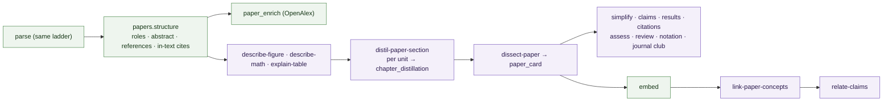

# Papers — Design

**Status**: building · **Date**: 2026-09-28 · **Extends**: [ARCHITECTURE.md](ARCHITECTURE.md)

A dedicated mode for scientific papers: understand them, distil them, extract every claim and
result, simplify them, rate them, and get told what to read next. It runs on the same
infrastructure as books (tree, anchors, artifacts, runner, gates, review queue, Qdrant, graph,
FSRS) with its **own skills, tables and pages**, because a paper is a different object: it makes
claims, reports results, and cites other papers.

---

## 1. Decisions

| # | Decision | Rationale | Consequence |
|---|---|---|---|
| P1 | **A paper is a document with `genre = 'paper'`**, not a new system | Every existing capability (reader, notes, recall, search, audio, stats) works on day one | `documents.genre` (`book` \| `paper` \| `article`); `kind` stays the file format |
| P2 | **Genre selects a pipeline profile** | A paper is 8–30 pages; section → chapter → brief is one rank too many | `app/papers/profile.py` plugs into the orchestrator; books are untouched |
| P3 | **Top-level sections are the paper's units** | The reader, recall, salience and flashcards all work per unit (chapter) | Parse keeps IMRaD sections at chapter depth; each gets a `role` |
| P4 | **The claim is the atom of a paper** | Papers are argued in claims; cross-paper supports/contradicts is only precise at claim grain | `claims` table, claim nodes in the graph, claim ↔ claim edges |
| P5 | **Skills write artifacts; materializers project them into tables** | Keeps D1 (derived data is rebuildable) and the review queue in charge | `claim_set` → `claims`, `citation_intents` → `paper_references.intent` |
| P6 | **Recommendation is deterministic; the model only explains** | Scores must be testable and cheap; LLM ranking is neither | `app/papers/scoring.py` is pure; `recommend-next` writes reasons for the top N |
| P7 | **External metadata is fetched on demand, never crawled** | Preserves the "ingest is deliberate" non-goal | OpenAlex via `httpx`; candidates are suggestions until you click "add to shelf" |
| P8 | **Your rating is yours; the assessment is the model's** | Same rule as D11 | `paper_ratings` (human, append-only) is separate from `paper_assessment` (artifact) |
| P9 | **GROBID is an optional parse adapter** | Best-in-class for scholarly PDFs, but it is a Java service | `BOOKSHELF_GROBID_URL` set → used for header + references; unset → PyMuPDF heuristics |

---

## 2. Data model (new)

```sql
alter table documents add column genre text not null default 'book'
  check (genre in ('book', 'paper', 'article'));

create table paper_meta (                     -- one per paper
  document_id    uuid primary key references documents on delete cascade,
  doi text, arxiv_id text, openalex_id text,
  venue text, year int, abstract text,
  fields text[] not null default '{}',        -- OpenAlex topics / concepts
  code_urls text[] not null default '{}', data_urls text[] not null default '{}',
  cited_by_count int, reference_count int,
  source text not null default 'parsed',      -- parsed | openalex | grobid | human
  enriched_at timestamptz, updated_at timestamptz not null default now()
);

create table paper_references (               -- the bibliography, one row per entry
  id uuid primary key, document_id uuid not null references documents on delete cascade,
  ordinal int not null,                       -- [n] or list position
  anchor text,                                -- the reference block
  raw text not null,
  title text, authors text[] not null default '{}', year int, venue text,
  doi text, arxiv_id text, openalex_id text,
  target_document_id uuid references documents on delete set null, -- on the shelf
  cited_at text[] not null default '{}',      -- anchors of in-text citations
  intent text,                                -- background|uses|extends|compares|contradicts (materialized)
  intent_cites text[] not null default '{}',
  unique (document_id, ordinal)
);

create table claims (                         -- materialized from the approved claim_set
  id uuid primary key, document_id uuid not null references documents on delete cascade,
  artifact_id uuid not null references artifacts on delete cascade,
  key text not null,                          -- 'C3', stable within one claim_set
  text text not null,
  kind text not null,                         -- method|result|theory|dataset|benchmark|position
  strength text not null,                     -- measured|argued|speculated
  evidence text[] not null,                   -- anchors
  unit text,                                  -- the section it belongs to
  unique (artifact_id, key)
);

create table paper_ratings (                  -- YOUR verdict; append-only, latest wins (P8)
  id uuid primary key, document_id uuid not null references documents on delete cascade,
  stars smallint not null check (stars between 1 and 5),
  verdict text check (verdict in ('must_read','useful','skim','skip')),
  note text, created_at timestamptz not null default now()
);

create table paper_passes (                   -- three-pass reading progress
  document_id uuid references documents on delete cascade,
  pass smallint check (pass between 1 and 3),
  completed_at timestamptz not null default now(), note text,
  primary key (document_id, pass)
);

create table reading_candidates (             -- papers to read next, off or on the shelf
  id uuid primary key,
  openalex_id text unique, doi text, arxiv_id text,
  title text not null, authors text[] not null default '{}', year int, venue text,
  abstract text, pdf_url text, cited_by_count int,
  sources jsonb not null default '[]',        -- [{kind: reference|cited_by|related|similar|watch, document_id}]
  score real not null default 0, score_parts jsonb not null default '{}',
  reason text, reason_cites text[] not null default '{}',  -- '<document_id>#<anchor>'
  status text not null default 'suggested',   -- suggested|queued|dismissed|ingested
  document_id uuid references documents on delete set null, -- after ingest
  created_at timestamptz not null default now(), updated_at timestamptz not null default now()
);

create table paper_sets (                     -- a user-chosen group to compare / synthesize
  id uuid primary key, name text not null,
  document_ids uuid[] not null, created_at timestamptz not null default now()
);
create table paper_syntheses (                -- literature review over a set (cross-document)
  id uuid primary key, set_id uuid not null references paper_sets on delete cascade,
  version int not null, body jsonb not null, citations text[] not null default '{}',
  origin text not null, model text, input_hash text not null,
  review text not null default 'draft', created_at timestamptz not null default now(),
  unique (set_id, version)
);
```

Extended enums (and their check constraints): concept `kind` gains `method · dataset · metric ·
task`; edge kinds gain `claim` and `document`; relations gain `cites`. RLS on, grants revoked,
like every other table (ARCHITECTURE §18).

As built (migration `20260928114609_papers.sql`):

- Every closed text column has a check; `backend/tests/papers/test_tables.py` asserts each
  check equals its Python enum. Existing web articles were backfilled to `genre = 'article'`.
- `paper_ratings` rows are wholly immutable (trigger `paper_ratings_are_immutable`, like
  `recalls`): a new rating supersedes, deleting is allowed.
- A human-chosen genre (ingest `genre`, or `PATCH /documents/{ref}`) sets
  `documents.meta.genre_source = 'human'`; `papers.detect` must not override it. A URL
  defaults to `article`, a file to `book` until detection.
- `edges` already allowed `document` endpoints; `claim` is new (ref id = the claim uuid).
  `cites` is a derived relation (`Relation.is_derived`), never proposed by a skill.
- The new concept kinds are paper-only (`ConceptKind.is_paper_only`): `link-concepts` keeps
  its five, `link-paper-concepts` proposes all nine.
- Job kinds. Stage skills get their own kind, because the kind picks the skill
  (`skill_for_job_kind`) and the orchestrator's rules key on it: `distil_paper_section`,
  `dissect_paper`, `link_paper_concepts`. The by-product skills (simplify, claims, results,
  citations, assess, review, notation, journal club) run as `derive` jobs naming their skill.
  Python jobs: `paper_structure` (re-runnable after an outline fix), `paper_enrich`,
  `paper_candidates`, `paper_watch`, `paper_fetch`, and `relate_claims`, `recommend_next`,
  `synthesize_papers`, which run their utility skill inline like `grade_recall`.
- No new `DocumentStatus`: approving the `paper_card` moves a paper to `distilled`.

---

## 3. Pipeline profile



- **Genre** is set at ingest (`POST /documents {path, genre?}`); absent, `papers.detect` guesses
  from the parsed tree (≤ 60 pages, an *Abstract* and a *References* heading).
- **Structure** (`papers.structure`, deterministic, after parse): tags each top-level section
  `meta.role` = `abstract · introduction · related_work · background · method · experiments ·
  results · discussion · limitations · conclusion · references · appendix · other`, marks
  references and acknowledgements as `skip` containers, fills `paper_meta` from page one
  (title, authors, DOI / arXiv id by regex), parses the bibliography into `paper_references`
  (numbered `[n]` and author-year styles) and links in-text markers to `cited_at` anchors.
- **Distillation**: `distil-paper-section` (distil tier) writes the existing
  `chapter_distillation` type per unit, so the reader pane works unchanged. Role-aware:
  methods keep setup, datasets, baselines and metrics; results keep every number.
  No section notes, no chapter summaries (the card's `tldr` serves as summary).
- **`dissect-paper`** replaces the brief: approving the `paper_card` moves the document to
  `distilled`. It queues embed and the paper derives.
- Everything else reuses: `mark-salience`, `grade-recall`, flashcards/quiz/FAQ,
  `write-audio-summary`, embed, statistics.

As built (parsing and structure, `detect · sections · headings · refblocks · outline ·
frontpage · refparse · citations · grobid · structure`):

- **Genre is guessed during the parse**, not after it: `handlers/parse.py` passes the PDF
  parser an `OutlineStrategy` (`papers.outline.paper_strategy`, a new hook in
  `parse.pdf.headings`), which runs paper heading detection, then `detect.guess_genre` on
  block signals (AUTO mode only; a `genre_source = human` genre forces or disables it). A
  detected paper gets `genre = paper` and `meta.genre_source = "detected"`; a later parse that
  no longer sees a paper reverts only a detected genre. Other formats and outline overrides
  are judged from the stored tree (`detect.tree_signals`).
- **Paper headings** (`papers.headings`): numbered `3` / `3.2` / `3.2.1` → levels 1/2/3 (the
  numbers must run in sequence), `Abstract · References · Acknowledgements · Appendix ·
  Limitations …` → units, `A` / `A.1` after the references → appendix, run-in
  `Acknowledgements We thank …` / `Abstract—…` split into heading + paragraph, the largest
  type on page one is the title (never a heading). The abstract is therefore its own unit
  whenever the parser saw its heading; `paper_structure` does not restructure stored nodes
  (that would renumber every anchor).
- **Auto-confirmed outlines**: a tier-2 paper skips `needs_review` when its outline proves
  itself (≥ 3 top-level sections numbered 1…n without gaps, Abstract and References found);
  the parse result carries a warning saying so. Otherwise it waits for a person, as books do.
  With an embedded outline and unproven detection, the embedded outline is used.
- **Bibliography blocks** (`papers.refblocks`): under the references heading, PDF lines are
  regrouped into one paragraph per entry (`[n]` markers, else the hanging indent, across
  columns and pages), tagged `meta.reference = true`; `refparse` takes those as entries.
- **Roles** are written by `paper_structure` on the stored top-level containers (so a human
  outline or a later genre change gets them too): keyword stems in priority order; an
  unmatched section between the introduction and the first experiments/results section is
  `method`; everything after the references is `appendix`; acknowledgements are `other` and
  `skip`, like the references. Front matter gets no role.
- **paper_meta** has no title/authors columns: the title goes to `documents.title` at parse
  (placeholder titles only), authors to `documents.authors` when empty. DOI / arXiv id / year /
  abstract / `reference_count` go to `paper_meta`; year = a venue line on page one, else the
  arXiv id's YYMM, else a copyright year. Page one is read from the PDF itself (the rotated
  arXiv stamp is furniture to the parser). A `source = openalex` row only gets its gaps
  filled; `human` is never touched.
- **References** upsert by `(document_id, ordinal)` (`[n]`, else position); an entry whose raw
  text changed loses its stale `intent`; vanished ordinals are deleted; `target_document_id`
  comes from `shelf.ShelfIndex.match`. **Citations**: `[n]` markers only in numbered
  bibliographies; author-year by first-author surname + year (+ `2018a` suffix, second
  author, `et al.`); footnotes attached to a leaf are scanned with it.
- **GROBID** (`BOOKSHELF_GROBID_URL`): header + references replace the heuristics; its entries
  borrow the parsed anchors/ordinals when the counts agree; a GROBID error degrades to the
  parsed structure instead of failing the job.

As built (`app/papers/profile.py`):

- `orchestrator.rules_for(document)` returns a `Rules(start, after_job, after_approval,
  after_rejection)` per genre; a paper gets `profile.RULES`, which start from the book tables
  and override only parse (→ `paper_structure`), `paper_structure` (→ `paper_enrich` + element
  jobs, else units), the element kinds and approvals (→ their unit), `distil_paper_section`,
  `dissect_paper` (an idempotency skip onto an approved card counts as approval, as for the
  brief) and the `chapter_distillation` / `paper_card` approvals. Embed → link → graph:
  `papers/graph_rules.py` (below, §5 "As built").
- **Units** (`papers/units.py`) are `Tree.chapters()` minus roles `abstract` and `references`:
  the abstract is not distilled (150–250 words; a distillation would be as long, and the card
  reads its blocks verbatim and cites them). An untagged paper distils every chapter.
- **Derive set** is data: `profile.PAPER_DERIVES = [Derive(skill, params, variant)]`, queued
  as `derive` jobs keyed `skill:<name>[:<variant>]` (the `POST /jobs` key, so manual and
  pipeline runs dedupe) on card approval, next to `embed`. Starts with `simplify-paper` at
  `level=practitioner`; later skills append. `AFTER_STRUCTURE` lists independent jobs queued
  when structure finishes (`enrich_spec`).
- **Shared artifact types**: a skill's `meta.yaml` may say `genre: paper`;
  `skill_for_artifact_type(catalogue, type, genre=)` (human-edit schema) picks the skill of
  the document's genre, else the genre-neutral one. Unique per `(artifact_type, genre)`.
- Selectors live in `app/papers/selectors/` (`common.py` pieces, `core.py`
  `paper_unit_blocks · paper_distillations · paper_explainer`), merged by
  `selectors.registry()`. A unit sees its own blocks, subsections, figure explanations and the
  bibliography entries it cites (`{ordinal, raw}`); the abstract and the outline come as
  anchor-free orientation, so citing them flags `out_of_scope_cites`. Paper inputs carry no
  OpenAlex counts or topics, so enrichment never re-runs a skill.
- `paper_card` and `paper_explainer` are in `INDEXED_TYPES`; `app/papers/render.py` flattens
  their fields into blocks for `body_blocks` (exports, search, evidence).

---

## 4. Skills (new)

| Skill | Output | Scope | Tier | Shape (all spans cited) |
|---|---|---|---|---|
| `distil-paper-section` | `chapter_distillation` | unit | distil | render blocks, role-aware |
| `dissect-paper` | `paper_card` | document | reason | `tldr`, `question`, `contributions[{kind, spans}]` (kind = a `ClaimKind`), `method` blocks, `setup {datasets, baselines, metrics: [{name, spans}]}`, `results` blocks (`table`/`chart`/prose/callouts), `limitations {stated[spans], unstated[spans]}`, `assumptions[spans]`, `future_work[spans]`, `numbers[{value,label}]`; every key always present |
| `simplify-paper` | `paper_explainer` | document | distil | param `level` newcomer · practitioner · expert → `variant`; `prerequisites[{concept, shelf_concept, why}]` (`shelf_concept` = an existing concept's canonical or null), `intuition` blocks, `walkthrough` blocks, `analogy` spans or null, `equations[{latex, plain, cites}]` (`cites` rather than `anchor`, so the anchor gate checks it) |
| `extract-claims` | `claim_set` → `claims` | document | distil | `claims[{key, text, kind, strength, cites}]` |
| `extract-results` | `results_table` | document | distil | `rows[{method, dataset, metric, value, unit, higher_is_better, is_proposed, setting?, cites}]` |
| `classify-citations` | `citation_intents` → `paper_references` | document | explore | `{citations: [{ordinal, intent, cites}]}`, reads each marker's sentence |
| `assess-paper` | `paper_assessment` | document | reason | `overall` spans; `scores[{criterion, score 1–5, spans}]` for novelty · rigour · evidence · clarity · reproducibility · relevance (each once); `reproducibility[{item, status: yes·partial·no·unknown, spans}]` checklist (ten fixed items, each once); `related_shelf[{slug, why}]` |
| `review-paper` | `paper_review` | document | reason | peer-review report: `summary`, `strengths[spans]`, `weaknesses[{severity: major·minor, spans}]`, `questions[spans]`, `missing_experiments[spans]`, `verdict {recommendation: accept·weak_accept·borderline·weak_reject·reject, confidence 1–5, spans}`; also an interactive Socratic reviewer in a Claude Code session (`/review-paper <slug> socratic`) |
| `make-notation` | `notation_table` | document | explore | `symbols[{symbol_latex, meaning, first_anchor, cites}]` |
| `explain-math` | `math_explainer` | document | distil | the maths for someone with no maths background: `big_picture {problem, map}` (a `diagram` of how the formulas feed the result), `formulas[1–8]` in learning order (each `anchor`, `latex`, `name`, `in_plain_words`, `symbols[{symbol, everyday}]`, `intuition`, `diagram`, `worked_example {setup, steps, result, extra}`, `why_here`, `added_value`, `common_confusion` caution callout, `try_it {question, answer}`, `explore_further`), `glossary` definitions, `love_note` insight callout, `path[{title, formula, minutes, goal}]` |
| `make-journal-club` | `journal_club` | document | distil | `pitch`, `key_figure {anchor, why} \| null`, `weakest_assumption {spans}`, `questions[5]`, `debate {for, against}` |
| `link-paper-concepts` | concepts + edges | document | reason | like `link-concepts`, with kinds method · dataset · metric · task |
| `relate-claims` | claim ↔ claim edges (proposed) | claim pair | reason | like `relate-concepts`: supports · contradicts · extends · none, cites both papers |
| `recommend-next` | `reading_candidates.reason` | shelf | reason | `[{candidate_id, reason, cites}]` for the top N |
| `synthesize-papers` | `paper_syntheses` | paper set | reason | related-work style blocks + comparison `table`, cites `<slug>:<anchor>` across the set |

Recommended by-products reuse existing skills (`mark-salience`, `make-flashcards` …) with no change.

As built (study and critique skills, `derive` jobs in `PAPER_DERIVES`, selectors in
`papers/selectors/study.py`, rendering in `papers/render_study.py`):

- **Cross-field hard gates** (`papers/checks.py`, `CHECKS[skill]`): run by
  `execution.output_problems` after the schema and anchor gates, so batch runs and
  interactive imports share them and a failure goes back on the one retry. Human edits keep
  the D15 bypass (schema only). Other paper skills register their own checks there.
- **`assess-paper`** (`paper_assessment` selector: whole paper + card + `shelf {papers:
  [{slug, title, authors, year, tldr}], concepts}`, the shelf being other papers' preferred
  non-rejected card TL;DRs, as `write-brief` reads the shelf). Deviations: `overall` spans and
  `related_shelf[{slug, why}]` (slugs checked against the input) back the `relevance` score;
  the checklist is closed: code · data · hyperparameters · seeds · compute · baselines ·
  ablations · statistical_significance · data_splits · evaluation_protocol. "Exactly once" is
  schema (`contains` + `minContains`/`maxContains`); "every score/item cited" is a check.
- **`review-paper`**: weaknesses carry `severity`; the verdict must cite. SKILL.md's
  interactive block has a report mode and a **Socratic mode** (`<slug> socratic`): it fetches
  `/skills/review-paper/inputs` (and verbatim blocks via `/nodes/<slug>/<anchor>`), asks one
  probing question at a time, pushes back with quoted, anchored passages, keeps a tally, and
  on request writes the report to `skills/.outbox/` and imports it. Batch mode stays JSON only.
- **`make-notation`** (explore; `paper_notation` selector: every formula, ≤ 150, with one
  prose leaf before and two leaves after it in its chapter, in reading order, plus describe-math
  explanations, plus the unit distillations' `math` blocks as `distilled_formulas` with the
  prose they cite — papers such as BERT write most notation inline, which the parser keeps as
  prose). Checks: one entry per symbol (whitespace and braces ignored), `first_anchor`
  and every cite are input blocks, no cite precedes `first_anchor`. "Contains the symbol" is not
  checked (LaTeX spellings vary too much to match reliably). Queued only when the paper has a
  formula (`Derive.when = has_math`); the selector raises otherwise.
- **`explain-math`** (distil; `paper_math` selector in `papers/selectors/explain_math.py`:
  `paper_notation`'s input plus the preferred `notation_table` symbols, the `paper_card` and
  `existing_concepts`). Distil, not reason: the maths is given, the job is teaching it, and
  Python checks what a model gets wrong (`papers/math_checks.py`, `CHECKS["explain-math"]`):
  each formula `anchor` is a `math` block of the input or the prose a `distilled_formulas`
  entry cites (a deviation from "math blocks only": BERT-style inline maths counts), once;
  `latex` matches the source (whitespace, braces, sizing and spacing commands aside, or one
  line of a multi-line source); every symbol is explained (best effort: letters and Greek
  letters outside sub/superscripts; `\mathrm{…}` names and letter runs of 3+ skipped); every
  `a op b = c` in a worked example or answer is recomputed at the precision written (`≈`
  allows one unit in the last place); diagram node ids unique and edges joined; cites only
  input anchors; `shelf_concept` from `existing_concepts`; path formulas chosen ones; a
  formula section under 900 words. Queued with `when=has_math`; rendered by
  `papers/render_math.py`; indexed. The paper page's `math` tab ("Math, explained", after
  explain) shows it; the notation tab and the reader's notation panel link to it ("Explain
  this math", `#formula-<anchor>` for a symbol used in a formula).
- **`make-journal-club`** (`paper_journal_club` selector: whole paper + card + `figures:
  [{anchor, caption, explanation}]`, figure nodes only). `key_figure` is null only when the paper
  has no figure; otherwise it must be one of the offered figures (check).
- All five are in `INDEXED_TYPES`; approving one (or a `paper_explainer`) on an indexed paper
  re-embeds it (`profile.INDEXED_DERIVES` → `orchestrator.guide_approved`).

As built (shelf-level skills, both utility skills run inline by their Python job, like
`grade-recall`; handlers in `pipeline/handlers/paper_shelf.py`):

- **`recommend-next`** (`papers/recommend.py`, input `papers/selectors/shelf.py`): the
  `recommend_next` job reads `payload.candidate_ids` (queued by `candidate_store` after every
  rebuild). Each candidate carries its facts, `score_parts`, and `leads`: every shelf paper in
  its `sources`, with your latest rating, the citation intents, and passages keyed
  `<document_id>#<anchor>`: the sentence around the `[n]` marker at each `cited_at` anchor
  (`citing_sentence`) and the card's TL;DR spans (`tldr`). Output is wrapped,
  `{reasons: [{candidate_id, reason, cites}]}` (a skill schema is an object). Hard checks:
  one reason per candidate; each cite is one of **that** candidate's passages (a paper that
  does not lead to it is refused); at least one cite when it has passages. Only `reason` and
  `reason_cites` are written, never `score`, `score_parts`, `status` or order (P6).
- **`synthesize-papers`** (`papers/synthesis.py`, input `papers/selectors/sets.py`): each
  member's preferred `paper_card`, its materialized `claims`, its preferred `results_table`
  rows and abstract (uncited), plus `comparison`, a results pivot. The pivot is a minimal
  local one (`selectors/sets.results_matrix`, names matched case- and space-insensitively),
  to be swapped for `papers.compare` once it exists. Output `{blocks, table}`.
- **Cross-document cites are `<slug>:<anchor>`**, the search answer's form
  (`retrieval/evidence.py`, `:` never occurs in a slug or anchor): render blocks cite
  anchors, and the qualifier says which paper. The API resolves them through a `sources`
  map (`{cite: {document: {id, slug, title, authors}, anchor}}`), exactly like the answer
  stream, so the frontend's `CiteSource` handling applies. Graph evidence (bridges,
  `relate-concepts`, `reason_cites`) keeps the id-keyed `<document_id>#<anchor>` form, since it
  names edge endpoints. Synthesis cites are **hard**-checked (unlike the answer, which drops
  bad ones): with qualifiers stripped the body must satisfy the render contract (heading,
  paragraph, bullets, callout, quote; `table` a render `table` block); every cite must be a
  key the input offered that still exists as a node; every member with citable passages must
  be cited. One retry with the problems, then the job fails.
- **Versions**: `input_hash = input_hash(skill, version, inputs)`; a non-rejected row with the
  same hash is returned without a model run unless `payload.force`; otherwise a new row,
  `version = max + 1`, review `draft`. Default read: latest approved, else latest draft.

---

## 5. Cross-paper features

- **Claim tracker**: after `embed`, claims are points (kind `claim`); `papers.claim_pairs`
  finds close cross-paper pairs and queues `relate-claims`. Accepted relations are claim ↔ claim
  edges; the reader margin shows "supported by 1 · contradicted by 2 on your shelf".
- **Citation graph**: `paper_references.target_document_id` gives `document —cites→ document`
  edges (with intent) on the map and in neighbourhoods.
- **Results comparison** (`papers.compare`, pure): pivots the `results_table` artifacts of a set
  into method × (dataset, metric), names normalized through concept aliases.
- **Recommendations** (`papers.candidates`, `papers.scoring`):
  candidates = references (backward) + OpenAlex citing works (forward) + OpenAlex
  `related_works` + abstract-embedding neighbours of papers you rated ≥ 4. Score combines your
  ratings of the papers that lead to it, how many shelf papers cite it, citation intent
  (`extends`/`uses` > `background`), citation count (log) and recency; `score_parts` keeps each
  term so the UI can explain it. The top N go to `recommend-next`.
- **Watch list**: papers rated ≥ 4 are watched; `paper_watch` (on demand, stale after 7 days)
  asks OpenAlex for new works citing them → candidates with source `watch`.
- **Add to shelf**: a candidate with an open-access PDF (arXiv or OpenAlex `best_oa_location`)
  downloads to `library/papers/<slug>.pdf` and ingests with `genre = paper`.

As built (claim tracker, `papers/claims.py · materialize.py · claim_points.py ·
claim_pairs.py`, `services/paper_claims.py`, `api/routes/paper_claims.py`):

- **`extract-claims`** (distil, derive, last of `PAPER_DERIVES`; `paper_claims` selector =
  `paper_distillations` + preferred card). `claims[{key C1…, text, kind, strength, cites}]`.
  Check (`claims.check_claims` in `papers/checks.py`): keys and normalised texts unique, a
  `measured` claim cites a `results`/`experiments` unit passage, a table `t…` or a figure `f…`.
- **Materializer** (`materialize.MATERIALIZERS[claim_set]`, run on approve, edit, reject and
  reopen: the profile adds `Rules.after_reopen`, a new orchestrator table). Effective = the
  latest *approved* claim_set (drafts never count; reopening v2 falls back to v1). **Claim
  ids are UUIDv5(document, normalised text)**, so a claim a new version keeps keeps its row,
  its point and its edges (key, evidence, unit follow the version); dropped claims are deleted
  with their claim ↔ claim edges. `unit` = the unit of the first cite inside one (null for an
  abstract-only claim). New claims queue `relate_claims`; any change on an indexed paper
  queues `embed`.
- **Points**: a separate Qdrant collection `claims` (**deviation** from "kind `claim`" in
  `distillations`: claims must not compete with prose in search, and neighbour queries filter
  on `document_id`), same named vectors, point id = claim id, payload `document_id, claim_id,
  key, kind, strength, unit, text`. Synced by `index_document` (the embed job).
- **Pairs** (`claim_pairs`, mirrors `graph/bridges.py`): the `relate_claims` job embeds claim
  sentences with the dense model in the worker (**deviation**: not a Qdrant query, so it runs
  outside the API that owns the embedded store), pairs across papers at cosine ≥
  `BOOKSHELF_CLAIM_RELATE_THRESHOLD` (0.6, measured on bge-small) skipping any pair with a
  claim ↔ claim edge, ≤ `_MAX_PAIRS` (12) per job; the job's paper is side A. `relate-claims`
  (utility, reason): supports · contradicts · extends → proposed edge, `none` → rejected edge
  (never asked again); evidence = the cited passages, ≥ 1 per paper.
- **Graph**: `EntityKind.CLAIM` resolves (`claim:<id>` or a bare id), labels as its sentence
  (sublabel `<paper> · <key>`, anchor = first evidence), shows in neighbourhoods, and folds to
  its unit in the atlas. Accept/reject through `PATCH /edges/{id}`.

As built (results, citation intents, linking and the citation graph):

- **`extract-results`** (distil, derive; `paper_results` selector: the results/experiments
  units, or every unit when none is tagged so, other table and figure blocks, their
  explanations with chart data, the card's setup names). The cite gate is the selection's
  `valid_anchors` (only those units and table/figure blocks), so a stray cite is a hard error
  retried once; `papers/extraction_checks.py` adds finite values and one row per (method,
  dataset, metric, `setting`). `setting` is optional (model size, ablation, ± spread).
- **`classify-citations`** (explore, derive; `paper_citations` selector,
  `papers/citation_context.py`): per in-text-cited entry, ≤ 3 citing passages as the
  sentence(s) around the marker (numbered or author-year, `et al.`-safe; a short sentence takes
  the one before it), ≤ 400 chars each, so a 150-entry bibliography stays one prompt. Output
  is an object `{citations: [...]}` (a schema's top level must be one). Check: ordinals
  offered and unique, each verdict cites its own reference's passages.
- **Intents materializer** (`papers/intents.py`, registered in `materialize.MATERIALIZERS`):
  the latest *approved* `citation_intents` → `paper_references.intent` / `intent_cites`,
  rebuilt on approve, edit, reject, reopen; a verdict keeps only cites in that reference's
  `cited_at` and is dropped when none remain. It re-seeds the paper's cites edges.
- **`link-paper-concepts`** (reason, job `link_paper_concepts`, `genre: paper`, writes
  `concept_links`, so `graph/apply.py` projects it unchanged; origin
  `skill:link-paper-concepts@<v>#…` is in `edges.LINK_ORIGINS`). `paper_concepts` selector:
  unit distillations + preferred card + preferred results table + shelf concepts.
  `graph_rules.embed_finished` (a paper's `EMBED` rule) queues it; **deviation**: the embed
  a graph refresh queues after concepts changed (`payload.reason = concepts`) does not
  re-link a paper (a book re-links, re-running the skill on its own new concepts). An approved
  `results_table` on an indexed paper re-queues the link (idempotent when unchanged).
- **Cites edges** (`papers/cites.py`): one `document —cites→ document` per reference with a
  `target_document_id`, origin `seed:cites@1`, accepted, evidence = `intent_cites` then
  `cited_at` (else the entry's anchor) qualified `<doc>#<anchor>`, weight by intent (extends
  1.0 · contradicts 0.9 · uses 0.8 · compares 0.7 · background 0.4 · none 0.5), `meta
  {ordinal, intent}`. `cites.refresh(doc)` reconciles the paper and every paper citing it; run
  by every graph refresh (`graph.pipeline.refresh_document`), after `paper_structure` and
  `paper_enrich`, and by the intents materializer. The atlas and neighbourhoods already draw
  document endpoints, so the edges show with relation `cites`.
- **Compare** (`papers/compare.py`, `services/paper_compare.py`, `GET /papers/compare?ids=`,
  ids or slugs, comma-separated or repeated, 1–20, non-paper 404): each paper's latest
  approved `results_table`; a name that is a concept's canonical or alias takes the concept's
  canonical (unless the concept is a *different* paper kind), else `normalize()` casefolding.
  Per column: direction = majority of `higher_is_better`, unit = most common unit, only cells
  in it are `comparable`, `best` marks every cell holding the best value once ≥ 2 are
  comparable. Response: `{papers: [{id, slug, title, year, results_artifact_id, rows}],
  columns: [{key, dataset, metric, unit, higher_is_better, best, cells}], rows: [{key,
  method, cells: [{column, paper_id, value, unit, setting, is_proposed, comparable, best,
  cites}]}]}`.

---

## 6. Reading

- **Three-pass mode** (reader, papers only). Pass 1 shows title, abstract, headings,
  introduction, conclusion and figures, then a card: category, contribution, worth a second
  pass? (saved as a `prediction`, reusing recalls). Pass 2 shows the body without appendix, with
  the notation table in a side panel. Pass 3 is everything, with the review questions as prompts.
  `paper_passes` records each.
- **Rating**: stars, verdict and a note, next to the model's assessment, never merged.

As built (reader, `frontend/src/components/reader/paper/`; `usePaperMode` is the one hook
`Reader.tsx` calls, inert for books): the reader still shows one top-level unit at a time, so a
pass works per unit by its `meta.role` (`passes.ts planUnit`). Pass 1 reads abstract,
introduction and conclusion in full; any other unit keeps its section headings, folded with
block count, words and minutes ("Read it anyway" unfolds one), and its figures **and tables**
(a table is a figure in most papers). References and appendix fold whole in passes 1 and 2.
Passes 1–2 draw figures and tables on a raised leaf. The mode (`p`, or Passes in the toolbar) is
remembered per paper in the reading preferences (`prefs.paperPasses`: document id → pass). The
pass closes at the foot of the conclusion (else the last body unit) for passes 1–2 and of the
last unit for pass 3 (`closingUnit`). Pass 1's three answers are one `prediction` recall filed
under the **abstract unit** (else the first unit; recalls accept any container anchor), then
`PUT /papers/{ref}/passes/1`; a retry after a failed pass write does not repeat the prediction.
The notation panel (the tabs' `NotationTable`) is offered in passes 2 **and 3**. Pass 3 lists
the latest non-rejected `paper_review` questions with their cites above "Mark pass 3 done".
Claim margin marks (any mode): `GET /documents/{ref}/claims/marks?unit=` on the server; a mark
whose anchor is not drawn moves to its nearest drawn ancestor (`claimMarks.ts`); the popover
reads `GET /papers/{ref}/claims` and shows `ClaimBadge` + `ClaimRelations` per claim.

---

## 7. API

```
GET    /papers?q=&venue=&year=&min_stars=&pass=&status=   the paper shelf
GET    /papers/{ref}                  meta · latest rating · passes · artifact status
PATCH  /papers/{ref}/meta             human fix-up (source = human)
POST   /papers/{ref}/enrich           → paper_enrich job
POST   /papers/{ref}/ratings          {stars, verdict?, note?};  GET → history
PUT    /papers/{ref}/passes/{pass}    {note?};  DELETE to undo
GET    /papers/{ref}/references       with shelf match, intent, candidate status
GET    /papers/{ref}/claims           claims + relation counts;  GET /claims/{id}/relations
GET    /documents/{ref}/claims/marks?unit=   reader margin: anchor → claims + counts
POST   /papers/claims/relate?document=   → relate_claims job per paper (202)
GET    /papers/compare?ids=           results matrix
GET    /papers/candidates?status=     reading queue, ranked
POST   /papers/candidates/refresh     rebuild candidates + recommend-next  → 202
PATCH  /papers/candidates/{id}        {status}
POST   /papers/candidates/{id}/ingest download + ingest → 202
POST   /papers/watch/refresh?force=   → paper_watch job (a paper is re-checked weekly unless force)
POST   /paper-sets · GET /paper-sets · GET /paper-sets/{id}
POST   /paper-sets/{id}/synthesis     → job;  GET → latest synthesis
DELETE /paper-sets/{id}                 (and its syntheses)
GET    /paper-sets/{id}/synthesis?version=
POST   /paper-sets/{id}/synthesis/{version}/review   {verdict: approve | reject}
```

Paper artifacts (`paper_card`, `paper_explainer`, …) go through the existing `/artifacts`
endpoints and review queue.

As built (shelf routes, `api/routes/papers.py` → `services/papers.py` for the shelf and
`services/paper_records.py` for meta / ratings / passes / references; wire shapes in
`schemas/paper_shelf.py`): `GET /papers` also takes `verdict=` and
`sort=recent|title|year|stars|cited_by`; `pass=0` means no pass yet, `pass=n` the highest
completed pass; `min_stars` and `verdict` read the latest rating; `year` is `paper_meta.year`,
else the document's. The page carries `facets` (venues, years) over the whole paper shelf. A
row lists the preferred document-scope artifact per paper type and variant (latest approved,
else latest non-rejected). `PATCH /meta` normalizes DOI / arXiv / OpenAlex ids. Routers with
fixed `/papers/<word>` paths (candidates, compare…) are included before `papers`.

As built (sets, `api/routes/paper_sets.py` → `services/paper_sets.py`, tag "paper sets"):
`POST /paper-sets` takes papers only (`422` otherwise), keeps order and drops duplicates;
`GET /paper-sets` is a `Page`; `GET /paper-sets/{id}` returns `members` as shelf rows
(`PaperSummary`) and a `synthesis` summary `{id, version, review, created_at}`;
`POST …/synthesis?force=` queues `synthesize_papers` (`202`, the live job on repeat, `422`
under two papers); `GET …/synthesis` adds `sources` for its `<slug>:<anchor>` cites.

---

## 8. Frontend

| Surface | Route | Notes |
|---|---|---|
| Papers shelf | `/papers` | a bookcase overview (a spine per paper on its year's plank: height = citations, colour = verdict, bands = passes, hatched = no card) over a catalogue of rows; venue, year, stars, pass, verdict facets; nav item |
| Paper | `/documents/[ref]/paper/[tab]` | tabs: card · explain (level switch) · math · claims · results · references · notation · review (assessment + reviewer report + your rating) · club · build ([BUILDS.md](BUILDS.md) §6) |
| Reader | existing | three-pass mode, claim margin marks, notation side panel |
| Next | `/papers/next` | ranked candidates, score breakdown, reason with cites, add / dismiss, watch refresh |
| Compare | `/papers/compare?ids=` | results matrix + bar chart per metric, "synthesize" → set |
| Set | `/papers/sets/[id]` | synthesis with cross-paper cites |
| Map / graph | existing | claim nodes, method/dataset/metric/task concept colours, `cites` edges |
| Today | existing | one "next paper" card when candidates exist |

Charts reuse `src/components/charts/` and the guide's stat tiles; the assessment is a bar chart,
not a radar.

As built (phase 4A): tabs are data, `components/papers/tabs.ts PAPER_TABS` (`key` = URL
segment, `types` = the artifacts whose readiness the tab bar shows) plus one Astro view per key
in `tab-views.ts` (`Record<PaperTabKey, …>`, so a missing view fails the type check); card,
explain and references exist. The header (`PaperHeader.astro`) carries your rating (append-only,
with history) and the pass tracker on every tab. `/documents/{ref}/paper` redirects to the card;
a non-paper answers 404 with a link back. "Add a paper" is `/library?add=paper` (the ingest desk
opens with genre paper chosen); the library filters by `genre`. The nav's Papers item also owns
`/documents/*/paper/*`.

As built (phase 4C, shelf-level pages): `/papers/next` ranks the queue as the API does, with
filters (status, source) as links; each candidate shows its reason with cites into the shelf
paper (`<document_id>#<anchor>` → reader), source chips naming the shelf papers behind them,
and "Why it ranks here", a one-hue bar list of `score_parts` on a page-wide scale (a term that
lowers the score, `rating` below 3 stars, grows left of a zero line). Add to shelf follows the
`paper_fetch` job and links to the new paper; dismiss folds to one line with Undo.
`/papers/compare?ids=` (comma-separated or repeated) is a GET picker form, the matrix, one bar
chart per (dataset, metric) coloured by paper, and "Save as set and synthesize".
`/papers/sets` and `/papers/sets/[id]`: set-page sigla follow set order; the version switcher
probes `?version=n+1` until a 404 (**deviation**: no versions endpoint). Today shows one
"Next paper" card (best `suggested`, else the best queued). The map: paper concept kinds get
a colour *and* a glyph inside the ring (no four series tokens stay CVD-apart, so the glyph
carries it); atlas document and chapter nodes carry `genre`, and the lens filters by it
(`genres=`).

As built (phase 4B): the remaining tabs — claims, results, notation, review, club — each read
their artifact (approved, else the newest draft with a draft note) and offer the `derive` job
when it is missing. Claims come from `GET /papers/{ref}/claims` once the claim set is approved
(a draft's claims are grouped client-side by the unit of their first cite and have no
relations); relations open from `GET /claims/{id}/relations` and are accepted or rejected with
`PATCH /edges/{id}`. Results pivot one paper's rows client-side (`components/papers/results.ts`,
same best rule as `papers/compare.py`) with one `HBars` chart per (dataset, metric) and a
"compare with…" picker (`/papers/compare?ids=a,b`, approved results tables only). Review shows
the model's assessment beside your latest rating, never merged. Reusable for the reader:
`ClaimBadge`, `ClaimRelations`, `NotationTable` (+ `notation.prepareSymbols`), and
`lib/papers/claims-api.ts` (`getClaimMarks`).

---

## 9. Module layout

```
backend/app/papers/
  detect.py  structure.py  refparse.py  citations.py  grobid.py     # parsing (deterministic)
  sections.py  headings.py  refblocks.py  outline.py  frontpage.py  # (parse-time outline strategy)
  works.py  openalex.py  http.py  shelf.py  enrich.py  candidates.py  candidate_store.py  # external
  scoring.py  watch.py  fetch_pdf.py  add.py                       # (handlers: pipeline/handlers/paper_external.py)
  materialize.py  claim_pairs.py  compare.py  intents.py  cites.py # derived projections
  claims.py  claim_points.py                                       # claim gate + identity · Qdrant points
  citation_context.py  extraction_checks.py  graph_rules.py        # classify-citations input · gates · link/graph rules
  profile.py                                                       # orchestrator branch
  recommend.py  synthesis.py                                       # shelf-level utility skills (handlers: paper_shelf.py)
  selectors/                                                       # skill input selectors
backend/app/api/routes/papers.py · paper_claims.py · paper_candidates.py · paper_sets.py · paper_compare.py
frontend/src/pages/papers/ · src/pages/documents/[ref]/paper/ · src/components/papers/
frontend/src/lib/api/types/papers.ts
```
